# Lab 2: Assess and Select Azure SQL Destinations with Azure Arc 

**Introduction**

Lab 1 told Fabrikam Retail what's on SQLVM01 and what stands in the way
of moving it. Leadership now wants the next answer: where should each
database go, what size does it need, and roughly what will it cost? As
Fabrikam's migration DBA, you connect SQLVM01 to Azure Arc so Azure can
discover and assess it continuously, then read the Arc migration
assessment for compatibility, sizing and cost. Finally, you test Arc's
verdict against dependencies you trace yourself, and finish with a
per-database recommendation, backed by evidence, that Lab 3 uses to
choose migration tooling.

**Objectives**

- Connect a SQL Server host to Azure Arc and confirm Arc discovers its
  instance and databases.

- Run and read the Arc migration assessment for each Azure SQL target:
  readiness, compatibility, size and cost.

- See how the migration strategy and pricing options change Arc's
  recommended target and cost.

- Trace which databases and server-level objects must move together.

- Produce a recommendation matrix and compare it with Arc's
  recommendation.

## **Exercise 1: Connect the SQL Estate to Azure Arc**

**Goal:** put SQLVM01 under Azure Arc so Azure discovers and assesses it
continuously, the way you'd onboard a customer's on-premises SQL Server.
Because SQLVM01 is an Azure VM, you first make it behave like a server
outside Azure.

### **Task 1: Remove the Azure VM extensions** 

1.  In the Azure portal, open **Virtual machines** \> **SQLVM01**.

2.  In the left menu, select **Settings** \> **Extensions +
    applications**.

3.  Observe that the only extension is **SqlIaasExtension**. Don't
    uninstall it here: it belongs to a separate **SQL virtual machine**
    resource, and deleting that resource is how you unregister it.

    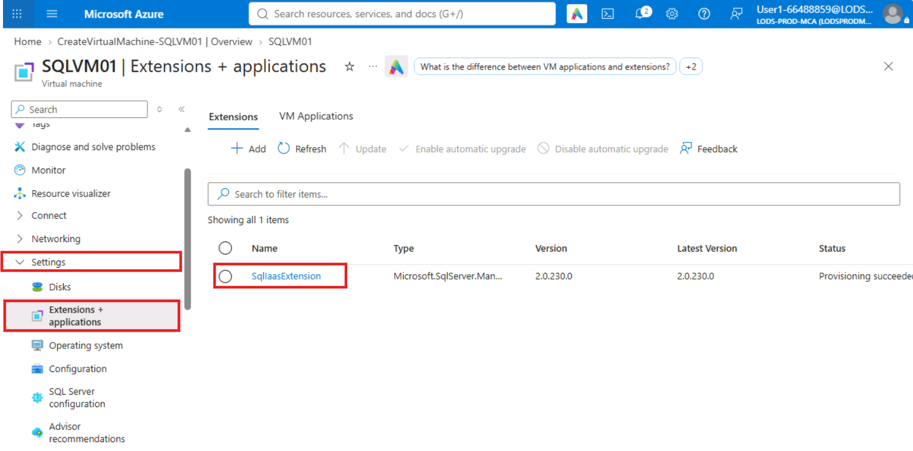

4.  In the portal top bar, click the **Cloud Shell icon (\>\_).** If
    asked, choose **Bash**.

    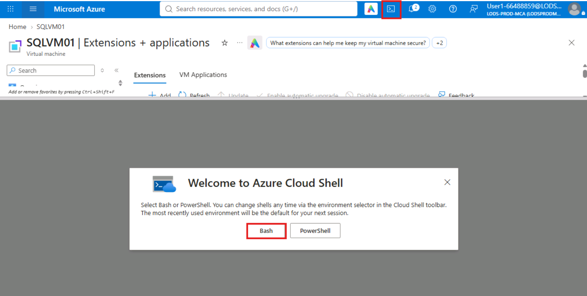

5.  Then, No storage account required and select your lab
    **subscription** and click **Apply**.

    

6.  Paste this command and press **Enter**. It removes only the SQL
    virtual machine registration; it can't delete the VM or its disks.

    ```
    az sql vm delete --name SQLVM01 --resource-group ResourceGroup1 --yes
    ```

    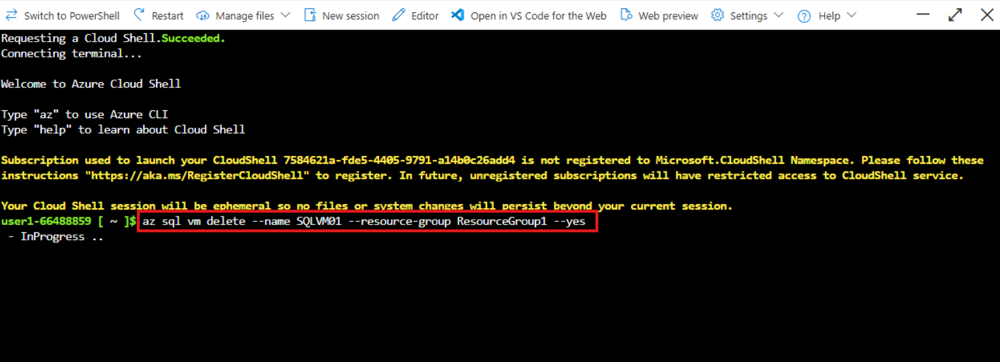

    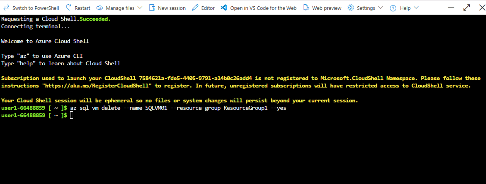

7.  Confirm the command returns to the prompt without an error. Then run
    this check, which should return an error saying the SQL virtual
    machine wasn't found:

    ```
    az sql vm show --name SQLVM01 --resource-group ResourceGroup1 --query name
    ```

    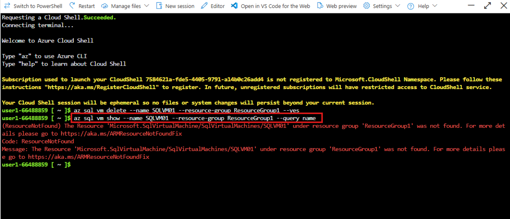

8.  Close Cloud Shell. Return to **Virtual machines** \> **SQLVM01** \>
    **Extensions + applications** and click **Refresh** until the list
    is empty (a few minutes).

    **Note**: If SqlIaasExtension is still listed after 5 minutes, select it
    and click **Uninstall**.

    

    The VM, SQL Server and your databases are unchanged. You only lose SQL
    features in the portal, such as automated patching and backup. From
    here on, Azure Arc is how Azure manages this SQL Server.

    From here on, **run command** no longer works on SQLVM01. You use RDP
    instead.

### **Task 2: Connect SQL Server to Azure Arc** 

You don't sign in to SQLVM01 for this. One Cloud Shell command sends a
script to the VM through **Run command**, the same mechanism you used in
Lab 1. The script prepares the VM for Arc evaluation, installs the Azure
Connected Machine agent, connects it to Arc with your own sign-in, and
then switches off the Azure guest agent.

1.  In the portal top bar, click the **Cloud Shell** icon (**\>\_**) and
    make sure it's in **Bash** mode.

2.  Paste the whole block below and press **Enter**. Copy it with the
    code block's copy button so the double hyphens (--) stay intact.

    ```
    # Your sign-in token, subscription and tenant, passed to the VM
    TOKEN=$(az account get-access-token --query accessToken -o tsv)
    SUB=$(az account show --query id -o tsv)
    TENANT=$(az account show --query tenantId -o tsv)

    cat > arc-onboard.ps1 <<'EOF'
    param([string]$token, [string]$sub, [string]$tenant)
    # 1. Mark the machine for Arc testing and block the Azure metadata endpoint
    [System.Environment]::SetEnvironmentVariable('MSFT_ARC_TEST', 'true', 'Machine')
    $env:MSFT_ARC_TEST = 'true'
    if (-not (Get-NetFirewallRule -Name BlockAzureIMDS -ErrorAction SilentlyContinue)) {
    New-NetFirewallRule -Name BlockAzureIMDS -DisplayName 'Block access to Azure IMDS' -Enabled True `
        -Profile Any -Direction Outbound -Action Block -RemoteAddress 169.254.169.254 | Out-Null }
    # 2. Install the Azure Connected Machine agent
    Invoke-WebRequest -UseBasicParsing -Uri 'https://aka.ms/azcmagent-windows' -OutFile "$env:TEMP\install_windows_azcmagent.ps1"
    & "$env:TEMP\install_windows_azcmagent.ps1"
    # 3. Connect the machine to Azure Arc
    & "$env:ProgramW6432\AzureConnectedMachineAgent\azcmagent.exe" connect --access-token $token `
    --subscription-id $sub --tenant-id $tenant --resource-group 'ResourceGroup1' --location 'eastus' --cloud 'AzureCloud'
    if ($LASTEXITCODE -ne 0) { Write-Output 'ARC CONNECT FAILED - read the messages above.'; exit 1 }
    # 4. Switch off the Azure guest agent one minute from now, after this script has reported back
    Set-Service WindowsAzureGuestAgent -StartupType Disabled
    $action  = New-ScheduledTaskAction -Execute 'powershell.exe' -Argument '-NoProfile -Command "Stop-Service WindowsAzureGuestAgent -Force"'
    $trigger = New-ScheduledTaskTrigger -Once -At (Get-Date).AddMinutes(1)
    Register-ScheduledTask -TaskName 'StopAzureGuestAgent' -Action $action -Trigger $trigger -User 'SYSTEM' -RunLevel Highest -Force | Out-Null
    Write-Output 'Arc onboarding complete.'
    EOF

    az vm run-command invoke --resource-group ResourceGroup1 --name SQLVM01 \
    --command-id RunPowerShellScript --scripts @arc-onboard.ps1 \
    --parameters "token=$TOKEN" "sub=$SUB" "tenant=$TENANT" \
    --query "value[].message" -o tsv
    ```

    

3.  Wait for the command to return (about 3–5 minutes; the cursor sits still while it runs).

4.  Confirm the output ends with **Arc onboarding complete**.

    

5.  **Close** the Cloud Shell.

From now on, **Run command** no longer works on SQLVM01, because its
Azure guest agent is switched off. Nothing later in this course needs
it.

The ResourceGroup1 and eastus values must match your lab. If your
resource group or region is named differently, change them in both the
script and the az command before you run it.

### **Task 3: Confirm discovery and start the assessments**

1.  In the portal, search for **Azure Arc.**

    

2.  Expand **Infrastructure \>** **Machines**. Confirm **SQLVM01** shows
    Status **Connected**.

    

3.  Open **Azure Arc** \> **Data services** \> **SQL Server instances**.
    Select **Refresh** until **SQLVM01** appears; the Azure extension
    for SQL Server can take a few minutes to install and report in.

    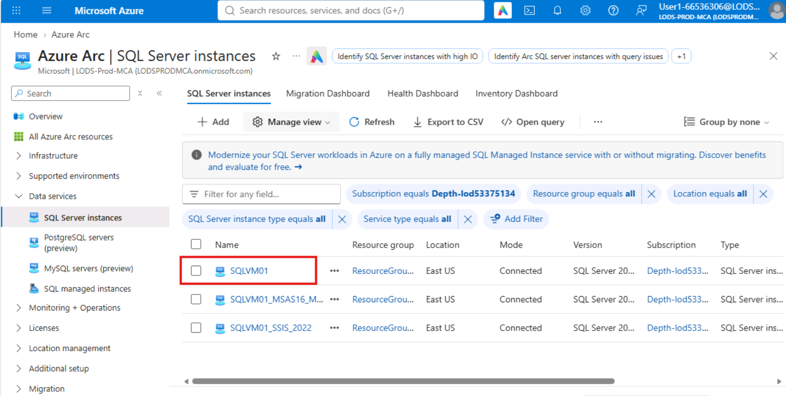

4.  Open the SQLVM01 SQL Server instance. In the left menu, under
    **Migration**, select **Assessments**, then click **Run
    assessment**.

    

5.  Create the Azure Migrate project that reads the same Arc data. Go
    back to Azure Arc by the top navigation.

    

6.  In **Azure Arc**, under **Migration**, select **Savings and
    Readiness (Preview)** and click **Create a migration** project.

    

7.  Set Name +++fabrikam-arc-migrate+++, your lab **Subscription**,
    Resource group **ResourceGroup1** and Region **West US 2**.

    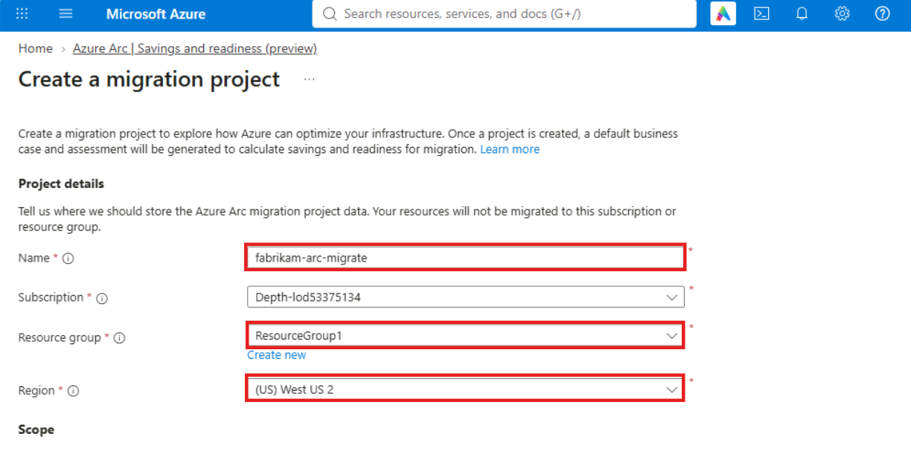

8.  Under **Scope**, select your lab subscription, set **Target region**
    to **West US 2**, and click **Create**.

    

    Both assessments now compute in the background. Azure Migrate typically
    produces its default assessments and business case within an hour, so
    you check it in the Wrap-up.

    

    **Note**: The project itself usually finishes in a few minutes, and the
    “Running” notification will turn green when it’s done. The slower part
    is what happens afterwards. Azure Migrate syncs SQLVM01’s data from Arc
    and builds the default assessment and two business cases, which can take
    up to an hour.

    **Proceed with the next exercise. You’ll come back to Azure Arc Assessment in Exercise 3.**

## **Exercise 2: Map workload dependencies**

**Goal:** find what no assessment tool reports, namely which databases
and server-level objects must move together. Lab 1 counted the
server-level objects; now you find out which database each one serves.
This runs on SQLVM01 while Azure computes your Arc assessment.

### **Task 1: Trace dependencies across databases and server objects**

1.  In SSMS, use the **sqladmin** connection to SQLVM01 and open a **New
    Query**.

    

2.  Paste the script and click **Execute**. It collects the code from
    every user database, then checks which database each Agent job,
    linked server and mail profile touches, and which databases
    reference each other.

    ```
    SET NOCOUNT ON;
    -- Collect every module definition from every user database
    IF OBJECT_ID('tempdb..#code') IS NOT NULL DROP TABLE #code;
    CREATE TABLE #code (db sysname, obj sysname, definition nvarchar(max));
    EXEC sp_MSforeachdb N'USE [?]; IF DB_ID() > 4
    INSERT #code SELECT DB_NAME(), OBJECT_NAME(object_id), definition FROM sys.sql_modules;';
    -- Grid 1: server-level objects and the database that depends on each
    SELECT N'Agent job step' AS object_type, j.name + N' / ' + s.step_name AS object_name,
        s.subsystem AS detail, ISNULL(d.name, N'(no database found)') AS used_by
    FROM msdb.dbo.sysjobs j
    JOIN msdb.dbo.sysjobsteps s ON s.job_id = j.job_id
    OUTER APPLY (SELECT TOP (1) name FROM sys.databases
                WHERE database_id > 4 AND s.command LIKE N'%' + name + N'%') d
    WHERE j.name <> N'syspolicy_purge_history'
    UNION ALL
    SELECT N'Linked server', ls.name, ls.product, ISNULL(c.db + N'.' + c.obj, N'(no code references it)')
    FROM sys.servers ls
    OUTER APPLY (SELECT TOP (1) db, obj FROM #code WHERE definition LIKE N'%' + ls.name + N'%') c
    WHERE ls.is_linked = 1
    UNION ALL
    SELECT N'Database Mail profile', p.name, N'Database Mail', ISNULL(c.db + N'.' + c.obj, N'(no code references it)')
    FROM msdb.dbo.sysmail_profile p
    OUTER APPLY (SELECT TOP (1) db, obj FROM #code WHERE definition LIKE N'%sp_send_dbmail%') c;

    -- Grid 2: databases referenced by code in another database
    SELECT d.name AS database_name,
        (SELECT STRING_AGG(c.db + N'.' + c.obj, N', ') FROM #code c
            WHERE c.db <> d.name AND c.definition LIKE N'%' + d.name + N'.%') AS referenced_by
    FROM sys.databases d
    WHERE d.database_id > 4
    ORDER BY d.name;
    ```

    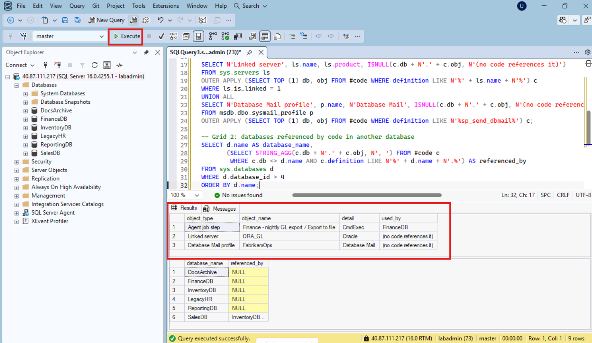

3.  Confirm that **Grid 1** returns these three rows:

    |object_type|object_name |detail| used_by|
    |------|--------|-------|-------|
    |Agent job step |Finance - nightly GL export / Export to file	|CmdExec  |FinanceDB  |
    |Linked server |ORA_GL	|Oracle  |(no code references it)  |
    |Database Mail profile |FabrikamOps	|Database Mail  |(no code references it)  |

4.  In **Grid 2**, confirm that only SalesDB has a value in
    referenced_by: **InventoryDB.usp_StockVsOrders**. Every other
    database is self-contained.

    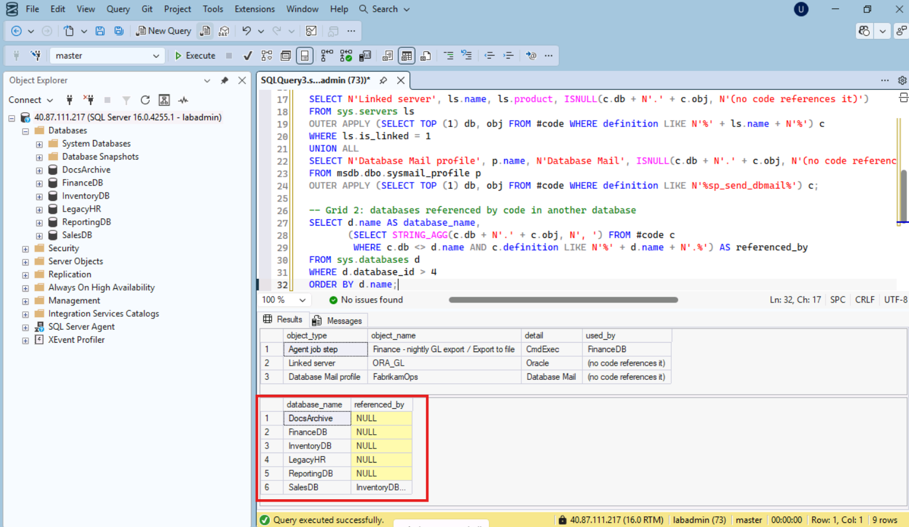

### **Task 2: Prove what dependencies mean**

Task 1 found the links. Now test them: what breaks when the databases
are split up, and whether the server-level objects are actually in use.

1.  **Break the affinity on purpose.** Open a **New Query** on the
    sqladmin connection.

    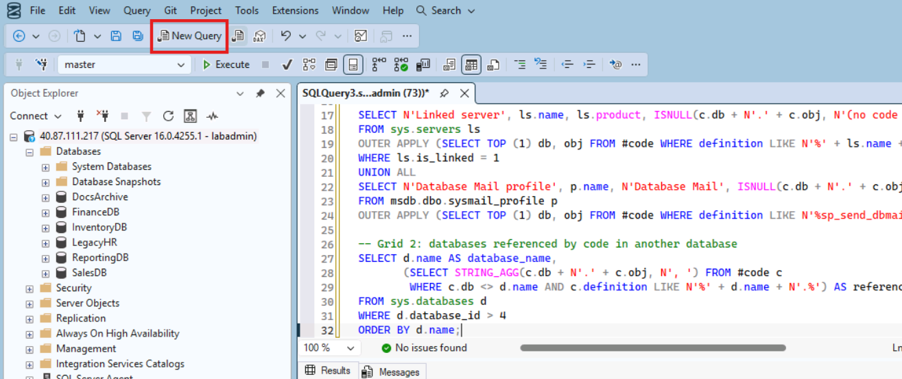

2.  Paste the script and click **Execute**. It runs InventoryDB's
    procedure, takes SalesDB offline as if SalesDB had moved to a
    different target, runs the procedure again, and brings SalesDB back
    online.

    ```
    SET NOCOUNT ON;
    EXEC InventoryDB.dbo.usp_StockVsOrders;   -- 1. Works while both databases share an instance
    ALTER DATABASE SalesDB SET OFFLINE WITH ROLLBACK IMMEDIATE;
    BEGIN TRY
    EXEC InventoryDB.dbo.usp_StockVsOrders; -- 2. SalesDB is "somewhere else"
    END TRY
    BEGIN CATCH
    SELECT N'InventoryDB without SalesDB' AS test, ERROR_NUMBER() AS error_number, ERROR_MESSAGE() AS error_message;
    END CATCH;
    ALTER DATABASE SalesDB SET ONLINE;         -- 3. Put it back
    SELECT name, state_desc FROM sys.databases WHERE name = N'SalesDB';
    ```

    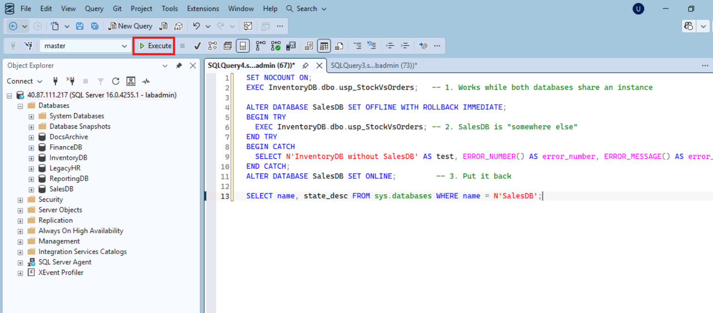

3.  In the **Results** tab, confirm the second grid shows error **942**,
    saying SalesDB can't be opened because it's offline. That's what
    InventoryDB hits if SalesDB lands on a different target. Confirm the
    last grid shows SalesDB **ONLINE** again.

    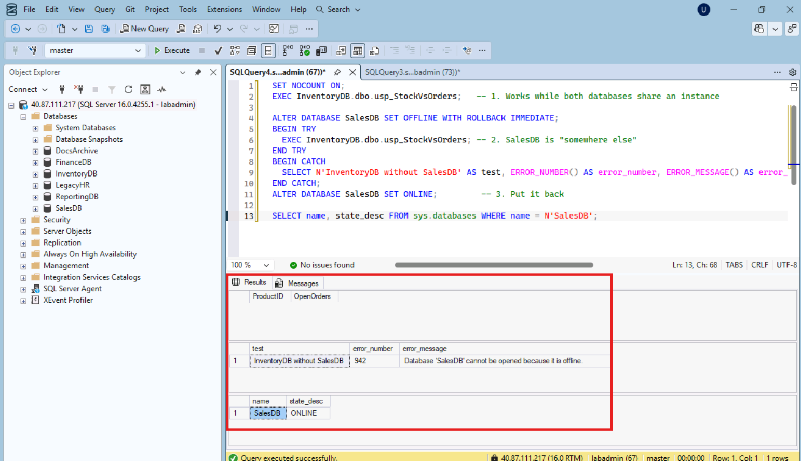

4.  **Check whether the server-level objects are used.** Open a **New
    Query**, paste the script and click **Execute**. It checks the GL
    export job's schedule and run history, the Database Mail history,
    and whether ORA_GL can reach its Oracle server.

    ```
    SET NOCOUNT ON;
    -- Agent job: is it scheduled, and has it ever run?
    SELECT j.name AS job_name,
        (SELECT COUNT(*) FROM msdb.dbo.sysjobschedules s WHERE s.job_id = j.job_id) AS schedules,
        (SELECT COUNT(*) FROM msdb.dbo.sysjobhistory h WHERE h.job_id = j.job_id AND h.step_id = 0) AS times_run
    FROM msdb.dbo.sysjobs j
    WHERE j.name = N'Finance - nightly GL export';
    -- Database Mail: has any mail ever been sent?
    SELECT COUNT(*) AS mails_sent FROM msdb.dbo.sysmail_allitems;

    -- Linked server: can ORA_GL reach anything?
    BEGIN TRY
    EXEC sp_testlinkedserver N'ORA_GL';
    SELECT N'ORA_GL' AS linked_server, N'Reachable' AS result, N'' AS detail;
    END TRY
    BEGIN CATCH
    SELECT N'ORA_GL' AS linked_server, N'Unreachable' AS result, ERROR_MESSAGE() AS detail;
    END CATCH;
    ```

    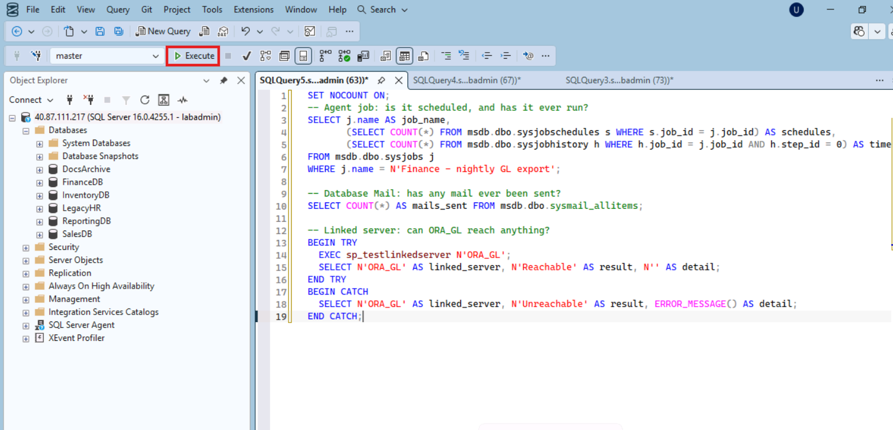

5.  Confirm the three grids show:

    |Check	|Expected result|What it tells you|
    |-------|-------|-------|
    |GL export job |schedules 0, times_run 0	|It has never run on this server. Ask Finance whether it runs from somewhere else before rebuilding it.  |
    |Database Mail |Valmails_sent 0ue	|FabrikamOps has never sent mail, so it's a candidate to retire.  |
    |ORA_GL |Unreachable, with a provider or connection error	|It can't work as configured, so nothing can depend on it today. That's evidence for retiring it rather than letting it force a VM.  |

    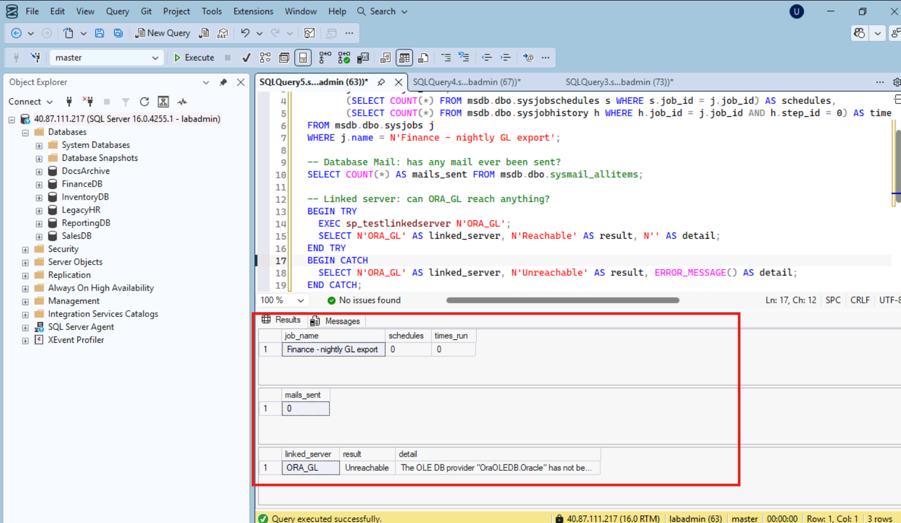

5.  **Save the job definition for Lab 3.** In Object Explorer, expand
    **SQL Server Agent** \> **Jobs**.

    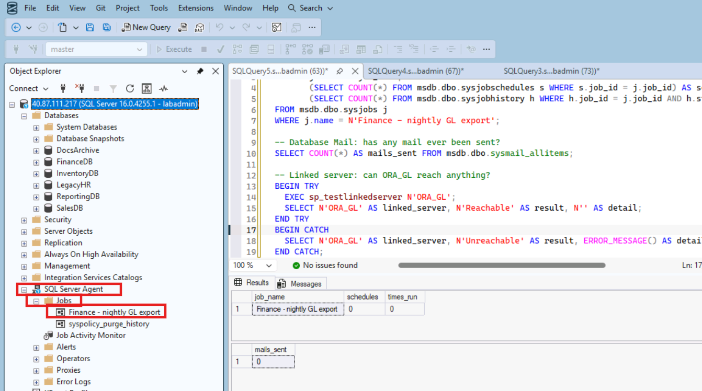

6.  Right-click **Finance - nightly GL export** and select **Script Job
    as** \> **CREATE To** \> **File**.

    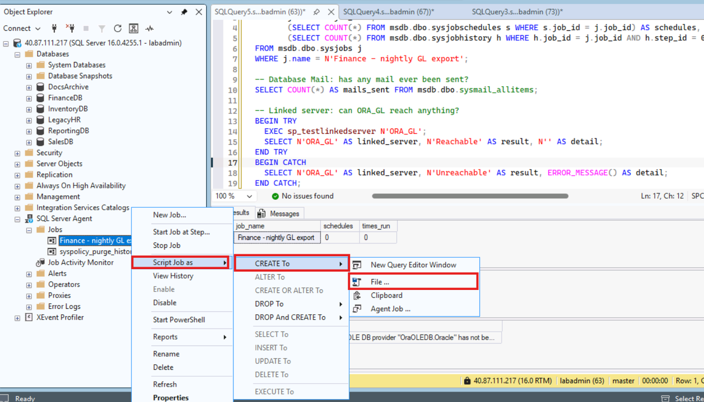

7.  Save it as +++GL_export_job.sql+++ in your Documents folder.

    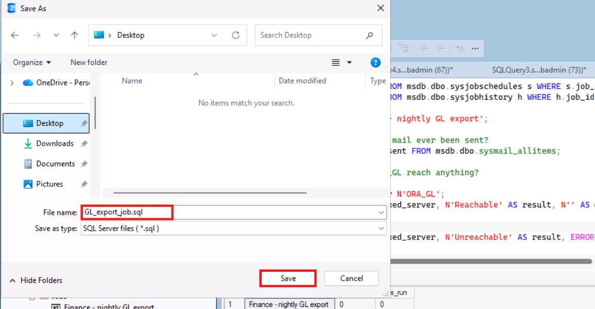

8.  In the saved script, find **@subsystem=N'CmdExec'**: this is the
    definition that has to be rebuilt outside SQL Server, because a
    database backup never carries it. In **SSMS**, click **File \> Open
    \> File**.

    

9.  Open **GL_export_job.sql**.

    

10. then press **Ctrl+F** and search for **CmdExec** to find
    **@subsystem=N'CmdExec'**. Don't execute the script; the job already
    exists: this is the definition that has to be rebuilt outside SQL
    Server, because a database backup never carries it.

    

Now return to the **portal** and check whether your Arc assessment has
finished.

## **Exercise 3: Review the Arc assessment: compatibility, sizing, and cost**

**Goal:** read the Arc migration assessment the way you'd present it to
a customer. You check what Arc discovered, compare readiness across the
three Azure SQL targets, and see how sizing, pricing options and
migration strategy shape its recommendation.

**If the assessment still shows as running, select Refresh every minute.
If it hasn't finished by Task 2, tell your instructor, who will share a
completed assessment for SQLVM01 so you can continue.**

### **Task 1: Check what Arc discovered**

1.  In **Azure Arc** \> **Data services** \> **SQL Server instances**,
    open **SQLVM01**.

    

2.  In the left menu, under **Migration**, select **Assessments**, then
    click **Refresh**.

    The assessment has **finished**, and you can start Exercise 3. The
    **Recommended Target: Azure SQL MI** card and **User databases (6)**
    only appear once results exist, and the **Assessment completed** time
    sits at the top right.

    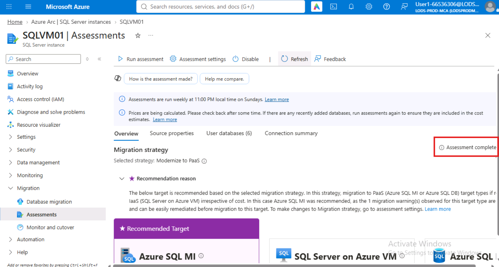

3.  On the **Overview** page, note the version, edition and license type
    that Arc reports.

    

4.  In the left menu, select **Data Management \>** **Databases**.

    

5.  Confirm Arc lists all **six Fabrikam databases**, including
    **LegacyHR**. Arc found them without any query from you, and it
    keeps the list current as databases are added.

    

#### **Task 2: Read the recommendation and readiness**

1.  In the left menu, under **Migration**, select **Assessments**. Check
    **Assessment completed at** to confirm you're looking at today's
    run.

    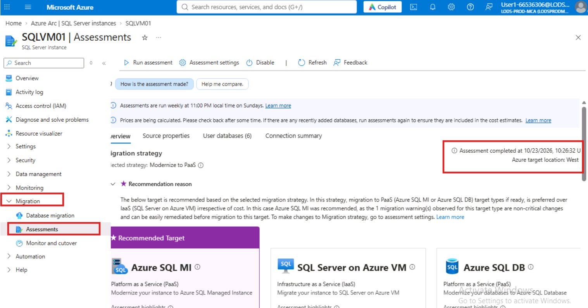

2.  Read the **Recommended Target** banner and the reasoning beside it.
    By default Arc uses the **Modernize to PaaS** strategy, so it
    prefers Managed Instance or Azure SQL Database if they're ready.

    

3.  In the details section, review the readiness summary for each
    target: **Azure SQL Managed Instance**, **SQL Server on Azure
    Virtual Machines** and **Azure SQL Database**. Observe that SQL
    Server on Azure VM is the most ready target, since it runs every
    feature SQLVM01 uses.

    

    

### **Task 3: Compare compatibility by target**

1.  In the target drop-down, select **Azure SQL Managed Instance**, then
    open the **Compatibility** tab.

    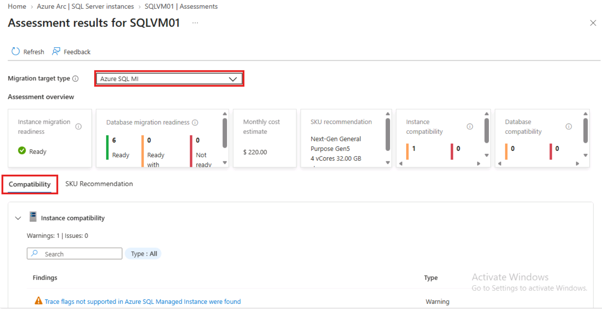

2.  Select the **Findings** Under **Instance** **compatibility**, select
    Trace flags not supported in Azure SQL Managed Instance were found.
    In the Finding details pane, confirm Type Warning and Impacted
    object **TraceFlag** **1117**, the trace flag Lab 1 found. Close the
    pane.

    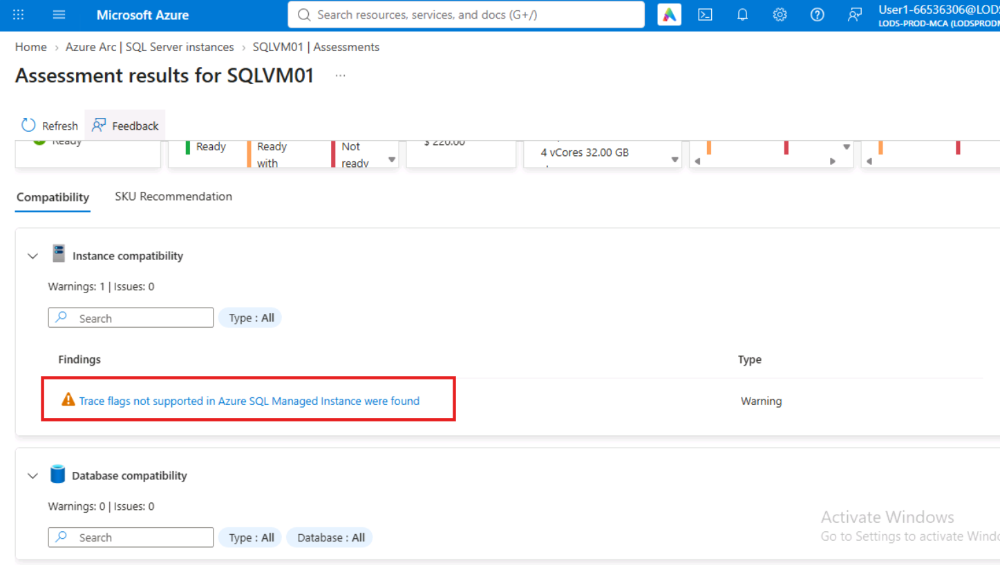

    

3.  Scroll down to **Database compatibility** and confirm it shows
    **Warnings: 0 | Issues: 0**.

    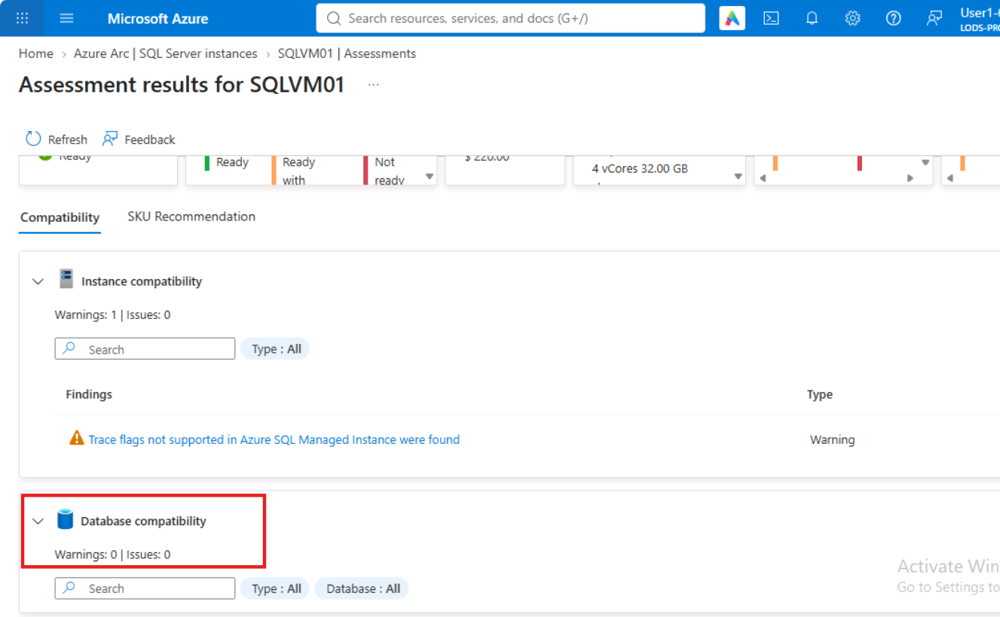

4.  Switch **Migration target type** to **Azure SQL Database**. Read the
    **Database migration readiness** card as Not ready.

    

5.  The findings on the **Database** **Compatibility** tab, and check
    whether InventoryDB's cross-database query from Exercise 2 is
    reported.

    

"**Ready**" in an assessment means the database can be moved, not that
everything around it will work afterwards. That's why Exercise 2 traced
the dependencies, and why Exercise 4 builds your own recommendation
instead of copying Arc's.

### **Task 4: Review the sizing recommendation**

1.  With **Azure SQL Managed Instance** selected, open the **SKU
    recommendation** tab. Note the recommended service tier, vCores and
    storage, and read the reasoning.

    

2.  Switch to **Azure SQL Database**. Observe that Arc gives a separate
    recommendation for each database rather than one for the instance.
    Select a **Recommendation reason** link to see why.

    

    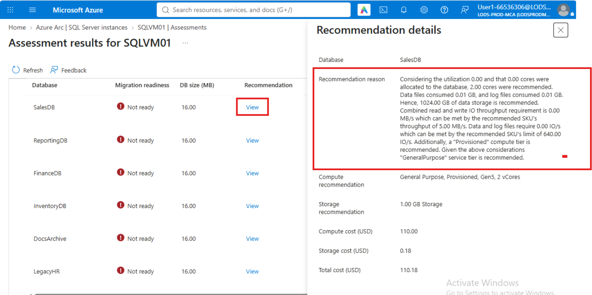

#### **Task 5: Change the pricing options and strategy**

1.  On **Assessment results for SQLVM01**, read the **Monthly cost
    estimate** card (the third summary card). Switch **Migration target
    type** between **Azure SQL MI**, **SQL Server on Azure VM** and
    **Azure SQL Database** to see each target's cost. If the card shows
    no price yet, prices are still being calculated; select **Refresh**
    after a minute.

    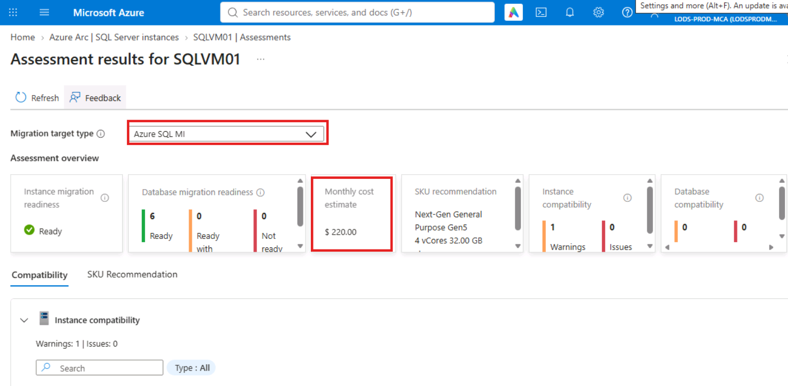

    

    

2.  Navigate back to **Assessments** page.

    

3.  Click **Assessment settings**.

    

4.  Click **Assessment settings**. **Azure Hybrid Benefit for SQL
    Server** is on by default. Turn it **off**, then click **Update**.

    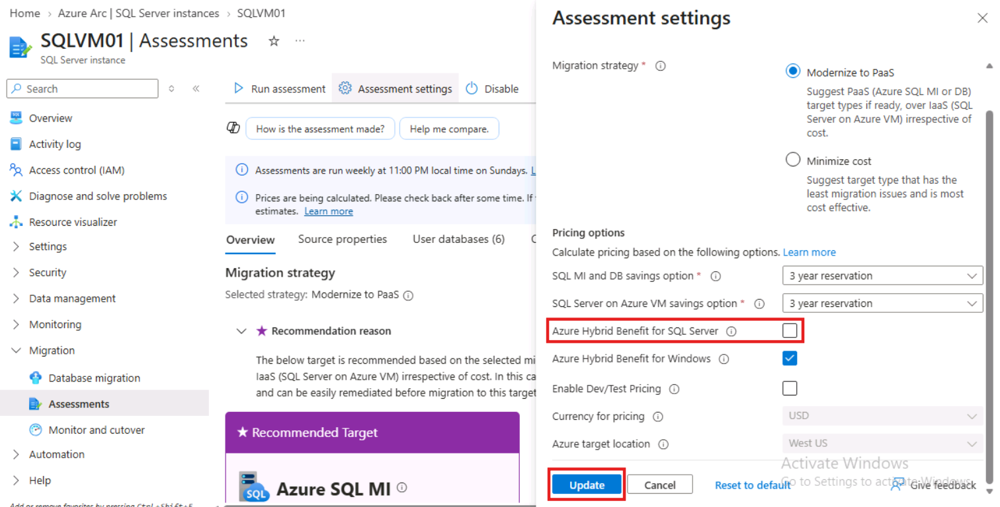

    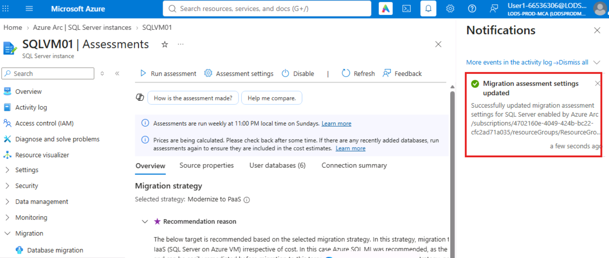

5.  Allow a minute for prices to recalculate, open the assessment
    details.

    

6.  Then check the **Monthly cost estimate** card for each target again.
    Observe how the costs rise: the difference is what Fabrikam saves by
    bringing its existing SQL Server licenses with Software Assurance to
    Azure.

    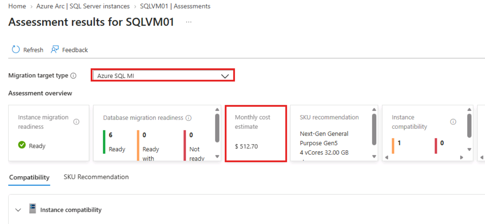

    

    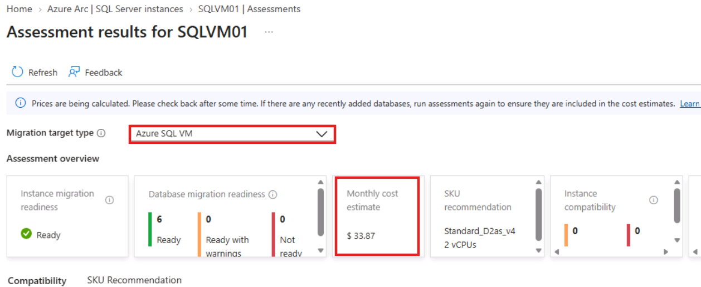

7.  Open **Assessment settings** again, change the migration strategy to
    **Minimize cost**, and click **Update**.

    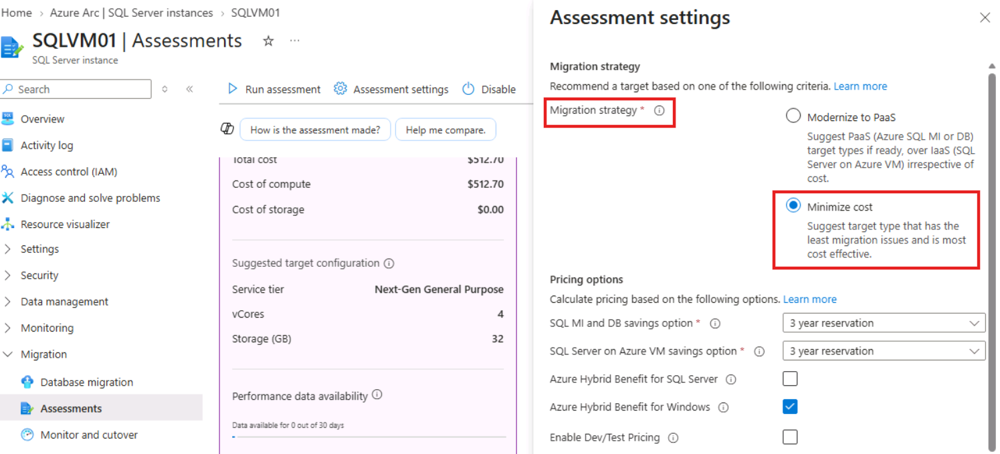

8.  Observe whether the **Recommended Target** banner changes. This
    strategy picks the cheapest target with the fewest issues and
    ignores the operational benefits of PaaS.

    

9.  Open **Assessment settings** once more, set the strategy back to
    **Modernize to PaaS**, turn **Azure Hybrid Benefit for SQL Server**
    off, and click **Update**.

    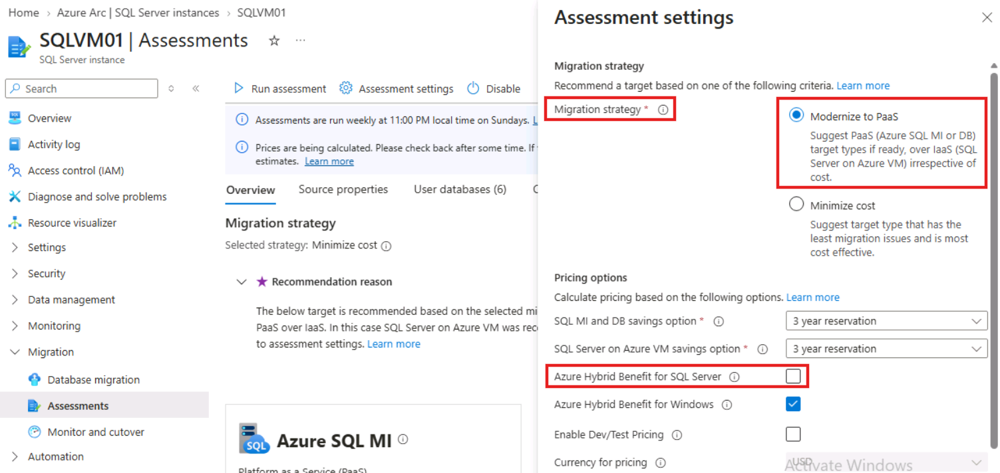

    

Arc gives you one recommendation for the whole instance. It can't see
the CmdExec job's business owner, the SalesDB–InventoryDB affinity, or
that LegacyHR may not be needed. Exercise 4 adds that judgment.

## **Exercise 4: Create a destination recommendation matric**

**Goal:** produce the per-database recommendation Arc can't give you.
You store the facts from Exercises 2 and 3 in a small **MigrationPlan**
database on SQLVM01, apply the decision flow below as a view, score each
target, and compare the result with Arc.

MigrationPlan is a working database for this course. Arc will list it in
later assessments; leave it out of any migration.

### **Task 1: Record the workload profile and run the decision flow**

1.  In SSMS, use the **sqladmin** connection to SQLVM01 and open a **New
    Query**.

2.  Paste the script and click **Execute**. It creates MigrationPlan,
    records what you've proved about each database and server-level
    object, and applies the decision flow. A database inherits the
    instance-scoped features of its affinity group.

    ```
    CREATE DATABASE MigrationPlan;
    GO
    USE MigrationPlan;
    GO
    SET NOCOUNT ON;
    CREATE TABLE dbo.WorkloadProfile (
    database_name    sysname PRIMARY KEY,
    still_needed     bit NOT NULL,
    vm_only_feature  nvarchar(100) NULL,
    instance_feature nvarchar(100) NULL,
    affinity_group   nvarchar(30) NULL,
    over_4tb         bit NOT NULL DEFAULT 0,
    condition_note   nvarchar(200) NULL);
    INSERT dbo.WorkloadProfile (database_name, still_needed, vm_only_feature, instance_feature, affinity_group, condition_note) VALUES
    (N'SalesDB',     1, NULL,          NULL,                              N'Inventory', N'Queried by InventoryDB.usp_StockVsOrders'),
    (N'InventoryDB', 1, NULL,          N'Cross-DB query; Service Broker', N'Inventory', NULL),
    (N'DocsArchive', 1, N'FILESTREAM', NULL,                              NULL,         N'Test the upgrade from compatibility level 100'),
    (N'FinanceDB',   1, NULL,          NULL,                              NULL,         N'Rebuild the GL export outside SQL Server; needs Finance sign-off'),
    (N'ReportingDB', 1, NULL,          NULL,                              NULL,         N'Move the daily feed file to Azure Blob Storage'),
    (N'LegacyHR',    0, NULL,          NULL,                              NULL,         N'Was offline in Lab 1; take a final backup and confirm with HR');

    CREATE TABLE dbo.ServerObjectDecisions (object_name nvarchar(60) PRIMARY KEY, decision nvarchar(60), reason nvarchar(200));
    INSERT dbo.ServerObjectDecisions VALUES
    (N'Finance - nightly GL export', N'Rebuild outside SQL Server', N'CmdExec runs on neither PaaS target'),
    (N'ORA_GL linked server',        N'Confirm owner, then retire', N'No database code uses it; Managed Instance cannot host Oracle linked servers'),
    (N'FabrikamOps Database Mail',   N'Recreate only if needed',    N'No database code sends mail; supported on Managed Instance'),
    (N'Trace flag 1117',             N'Drop',                       N'No effect since SQL Server 2016; AUTOGROW_ALL_FILES replaces it'),
    (N'xp_cmdshell',                 N'Leave disabled',             N'Nothing on the chosen targets needs it'),
    (N'SSIS service',                N'Plan in Lab 3',              N'Packages need their own migration path');
    GO
    CREATE VIEW dbo.vDestinationFlow AS
    SELECT w.database_name,
    CASE
        WHEN w.still_needed = 0            THEN N'1. Not needed'
        WHEN w.vm_only_feature IS NOT NULL THEN N'2. VM-only feature: ' + w.vm_only_feature
        WHEN g.group_feature IS NOT NULL   THEN N'3. Instance-scoped: ' + g.group_feature
        WHEN w.over_4tb = 1                THEN N'4. Over 4 TB'
        ELSE N'5. No blockers'
    END AS rule_matched,
    CASE
        WHEN w.still_needed = 0            THEN N'Retire'
        WHEN w.vm_only_feature IS NOT NULL THEN N'SQL Server on Azure VM'
        WHEN g.group_feature IS NOT NULL   THEN N'Azure SQL Managed Instance'
        WHEN w.over_4tb = 1                THEN N'Azure SQL Database Hyperscale'
        ELSE N'Azure SQL Database'
    END AS destination,
    w.condition_note
    FROM dbo.WorkloadProfile w
    OUTER APPLY (SELECT TOP (1) i.instance_feature AS group_feature
                FROM dbo.WorkloadProfile i
                WHERE i.instance_feature IS NOT NULL
                AND (i.database_name = w.database_name OR i.affinity_group = w.affinity_group)) g;
    GO
    SELECT * FROM dbo.vDestinationFlow ORDER BY destination, database_name;
    ```

    

3.  Confirm the grid matches this:

    |database_name	|rule_matched|destination|
    |-------|-------|-------|
    |FinanceDB |5. No blockers	|Azure SQL Database  |
    |ReportingDB |5. No blockers	|Azure SQL Database  |
    |InventoryDB |3. Instance-scoped: Cross-DB query; Service Broker	|Azure SQL Managed Instance  |
    |SalesDB |3. Instance-scoped: Cross-DB query; Service Broker	|Azure SQL Managed Instance  |
    |LegacyHR |1. Not needed	|Retire  |
    |DocsArchive |2. VM-only feature: FILESTREAM	|SQL Server on Azure VM  |

    

#### **Task 2: Score the targets and publish the recommendation**

1.  Open a **New Query** on the sqladmin connection, paste the script
    and click Execute. It loads the weights and scores, builds a
    weighted matrix that excludes any target with compatibility 1, and
    publishes dbo.vRecommendation. Scores run from 1 (poor) to 5
    (excellent); a compatibility of 4 means the target works after the
    change in condition_note.

    ```
    USE MigrationPlan;
    GO
    SET NOCOUNT ON;
    CREATE TABLE dbo.Weights (compat decimal(3,2), ops decimal(3,2), ha decimal(3,2),
                            cost decimal(3,2), scale decimal(3,2), effort decimal(3,2));
    -- Compatibility 30%, operational overhead 20%, HA/DR 15%, cost 15%, scalability 10%, migration effort 10%
    INSERT dbo.Weights VALUES (0.30, 0.20, 0.15, 0.15, 0.10, 0.10);

    CREATE TABLE dbo.Scores (database_name sysname, target nvarchar(40),
    compat tinyint, ops tinyint, ha tinyint, cost tinyint, scale tinyint, effort tinyint,
    PRIMARY KEY (database_name, target));
    INSERT dbo.Scores VALUES
    -- database        target                          compat ops ha cost scale effort
    (N'InventoryDB', N'Azure SQL Database',          1, 5, 5, 4, 4, 2),
    (N'InventoryDB', N'Azure SQL Managed Instance',  5, 4, 5, 3, 3, 5),
    (N'InventoryDB', N'SQL Server on Azure VM',      5, 2, 3, 3, 4, 4),
    (N'SalesDB',     N'Azure SQL Database',          5, 5, 5, 4, 4, 4),
    (N'SalesDB',     N'Azure SQL Managed Instance',  5, 4, 5, 3, 3, 5),
    (N'SalesDB',     N'SQL Server on Azure VM',      5, 2, 3, 3, 4, 4),
    (N'DocsArchive', N'Azure SQL Database',          1, 5, 5, 4, 4, 2),
    (N'DocsArchive', N'Azure SQL Managed Instance',  1, 4, 5, 3, 3, 3),
    (N'DocsArchive', N'SQL Server on Azure VM',      5, 2, 3, 3, 4, 4),
    (N'FinanceDB',   N'Azure SQL Database',          4, 5, 5, 4, 4, 3),
    (N'FinanceDB',   N'Azure SQL Managed Instance',  4, 4, 5, 3, 3, 3),
    (N'FinanceDB',   N'SQL Server on Azure VM',      5, 2, 3, 3, 4, 4),
    (N'ReportingDB', N'Azure SQL Database',          4, 5, 5, 4, 4, 4),
    (N'ReportingDB', N'Azure SQL Managed Instance',  4, 4, 5, 3, 3, 4),
    (N'ReportingDB', N'SQL Server on Azure VM',      5, 2, 3, 3, 4, 4);
    GO
    CREATE VIEW dbo.vScoreMatrix AS
    WITH s AS (
    SELECT sc.database_name, sc.target,
            CAST(sc.compat * w.compat + sc.ops * w.ops + sc.ha * w.ha + sc.cost * w.cost
                + sc.scale * w.scale + sc.effort * w.effort AS decimal(4,2)) AS score,
            IIF(sc.compat = 1, 1, 0) AS excluded
    FROM dbo.Scores sc CROSS JOIN dbo.Weights w),
    r AS (
    SELECT *, ROW_NUMBER() OVER (PARTITION BY database_name ORDER BY excluded, score DESC) AS rn
    FROM s)
    SELECT database_name,
    MAX(CASE WHEN target = N'Azure SQL Database'         THEN CONCAT(score, IIF(excluded = 1, N' (excluded)', N'')) END) AS azure_sql_database,
    MAX(CASE WHEN target = N'Azure SQL Managed Instance' THEN CONCAT(score, IIF(excluded = 1, N' (excluded)', N'')) END) AS managed_instance,
    MAX(CASE WHEN target = N'SQL Server on Azure VM'     THEN CONCAT(score, IIF(excluded = 1, N' (excluded)', N'')) END) AS sql_server_on_vm,
    MAX(CASE WHEN rn = 1 THEN target END) AS best_by_score,
    MAX(CASE WHEN rn = 1 THEN score END)  AS best_score
    FROM r
    GROUP BY database_name;
    GO
    CREATE VIEW dbo.vRecommendation AS
    SELECT f.database_name,
        f.destination AS recommended_destination,
        m.best_by_score,
        m.best_score,
        CASE WHEN m.best_by_score IS NULL         THEN N'Not scored: retiring'
                WHEN m.best_by_score = f.destination THEN N'Score agrees'
                ELSE N'Score differs: see rule_matched' END AS check_result,
        f.rule_matched,
        f.condition_note
    FROM dbo.vDestinationFlow f
    LEFT JOIN dbo.vScoreMatrix m ON m.database_name = f.database_name;
    GO
    SELECT * FROM dbo.vScoreMatrix ORDER BY database_name;
    SELECT * FROM dbo.vRecommendation ORDER BY recommended_destination, database_name;
    ```

    

2.  Confirm the first grid (the score matrix) matches this:

    |database_name	|azure_sql_database|managed_instance|sql_server_on_vm|best_by_score|
    |-------|-------|-------|-------|-------|
    |DocsArchive |3.25 (excluded)	|2.90 (excluded) |3.60	|SQL Server on Azure VM |
    |FinanceDB |4.25	|3.80 |3.60	|Azure SQL Database |
    |InventoryDB |3.25 (excluded)	|4.30 |3.60	|VaAzure SQL Managed Instancelue |
    |ReportingDB |4.35	|3.90 |3.60	|Azure SQL Database |
    |SalesDB |4.35	|4.30 |3.60	|Azure SQL Database |

    

3.  In the second grid, confirm **Score agrees** for DocsArchive,
    FinanceDB, InventoryDB and ReportingDB, and **Not scored: retiring**
    for LegacyHR.

    

4.  Find **SalesDB**: its check_result is **Score differs: see
    rule_matched**. Scored alone it picks Azure SQL Database (4.65), but
    it inherits InventoryDB's instance-scoped features, so it goes to
    Managed Instance.

    

### **Task 3: Compare your plan with Arc**

1.  In the portal, open the Arc **Assessment results for SQLVM01** page
    with **Migration target type** set to **Azure SQL MI**. Read the
    **SKU recommendation** and **Monthly cost estimate** cards.

    

2.  In SSMS, open a **New Query** on the sqladmin connection and paste
    the script below. If your portal shows a different SKU or cost from
    the values in the INSERT line, change them to match. Then click
    **Execute**.

    ```
    USE MigrationPlan;
    GO
    SET NOCOUNT ON;
    -- Arc's recommendation for the whole SQLVM01 instance (values from your portal)
    CREATE TABLE dbo.ArcAssessment (target nvarchar(40) PRIMARY KEY, sku nvarchar(100), monthly_cost_usd decimal(10,2));
    INSERT dbo.ArcAssessment VALUES
    (N'Azure SQL Managed Instance', N'Next-Gen General Purpose Gen5, 4 vCores, 32.00 GB storage', 512.70);
    GO
    CREATE VIEW dbo.vPlanVsArc AS
    SELECT r.database_name,
        r.recommended_destination AS our_plan,
        a.target AS arc_recommends,
        IIF(r.recommended_destination = a.target, N'Agrees', N'Differs') AS comparison,
        IIF(r.recommended_destination = a.target, a.sku, N'') AS starting_size,
        CASE
            WHEN r.recommended_destination = a.target          THEN N'Arc and the plan agree; use Arc''s SKU as the starting size'
            WHEN r.recommended_destination = N'Retire'         THEN N'Arc assesses every online database; only the business knows it is unused'
            WHEN r.recommended_destination = N'SQL Server on Azure VM'
                                                                THEN N'Arc did not flag ' + w.vm_only_feature + N', which Managed Instance does not support'
            ELSE N'No instance-scoped features, so it can use lower-management Azure SQL Database; Arc picks one target for the whole instance'
        END AS why
    FROM dbo.vRecommendation r
    JOIN dbo.WorkloadProfile w ON w.database_name = r.database_name
    CROSS JOIN dbo.ArcAssessment a;
    GO
    SELECT database_name, our_plan, arc_recommends, comparison, starting_size, why
    FROM dbo.vPlanVsArc ORDER BY comparison, database_name;
    ```

    

3.  Confirm the grid matches this:

    |database_name	|our_plan|arc_recommends|comparison|
    |-------|-------|
    |Value |Value	|Value  |Value |
    |Value |Value	|Value  |Value |
    |Value |Value	|Value  |Value |
    |Value |Value	|Value  |Value |
    |Value |Value	|Value  |Value |
    |Value |Value	|Value  |Value |

    

4.  Read the **why** column for the four **Differs** rows. Each names
    the evidence Arc didn't have: a feature it didn't flag, a business
    decision, or a database that doesn't need an instance.

    

5.  Check the **starting_size** column for **InventoryDB** and
    **SalesDB**. Arc's Managed Instance SKU is where the InventoryDB and
    SalesDB group starts.

    

## **Conclusion**

In this lab, you connected a SQL Server host to Azure Arc and watched
Azure discover its instance and databases without a single query from
you. You read the Arc migration assessment across all three Azure SQL
targets and saw how sizing, Azure Hybrid Benefit and the migration
strategy shape its recommendation and cost. You also saw its limits: Arc
rated every database Ready for Managed Instance, yet FILESTREAM, the
Oracle linked server, the CmdExec job and xp_cmdshell would all break
there. By tracing dependencies, testing them and scoring each target,
you built a recommendation that splits the estate across Azure SQL
Database, Managed Instance and SQL Server on Azure VM, and retires a
database nobody uses. An assessment tells you what can move; your
evidence tells you where it should go.
