# **Lab 6: Evaluate Azure SQL Database Hyperscale as a Migration Destination**

**Lab overview**

In Lab 5, Fabrikam Retail deployed ReportingDB to Azure SQL Database
General Purpose. Since then, two things have changed:

- **Growth:** the analytics team plans to load five years of sales
  history plus a daily feed. ReportingDB is now forecast to pass 4 TB
  within two years, which is the General Purpose storage limit.

- **New workloads:** Power BI dashboards and a new AI sales-forecasting
  service will run heavy read queries all day. The team doesn’t want
  them to slow down the daily feed that writes to the database.

Lab 2’s decision flow sends a database over 4 TB, or one that needs to
scale reads independently, to **Hyperscale**. Your task is to prove that
Hyperscale meets both needs before the team changes ReportingDB’s
destination.

**Objectives**

After completing this lab, you will be able to:

- Deploy an Azure SQL Database Hyperscale database and identify its
  storage architecture.

- Create a Hyperscale named replica and use it to isolate read-only
  reporting and AI workloads.

- Prove that a named replica is read-only and stays in sync with the
  primary.

- Scale Hyperscale compute independently on the primary and the named
  replica.

- Explain why choosing Hyperscale is a one-way decision for a new
  database.

## **Exercise 1: Deploy an Azure SQL Database Hyperscale Database**

You deploy a Hyperscale database with the AdventureWorksLT sample, which
stands in for ReportingDB’s data, and confirm how its storage differs
from General Purpose.

### **Task 1: Create the Hyperscale database**

1.  Open [***portal.azure.com***](https://portal.azure.com/) and sign in
    with your lab account.

    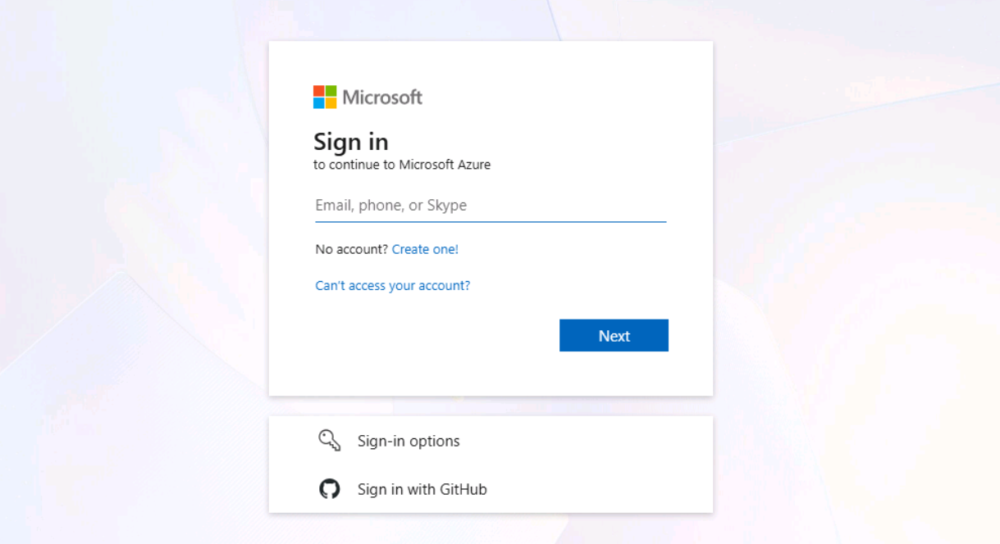

2.  In the portal search bar, type +++SQL databases+++. Under
    **Services**, select **Azure SQL Database**.

    

3.  Click **+ Create**. If a menu opens, select **SQL database**.

    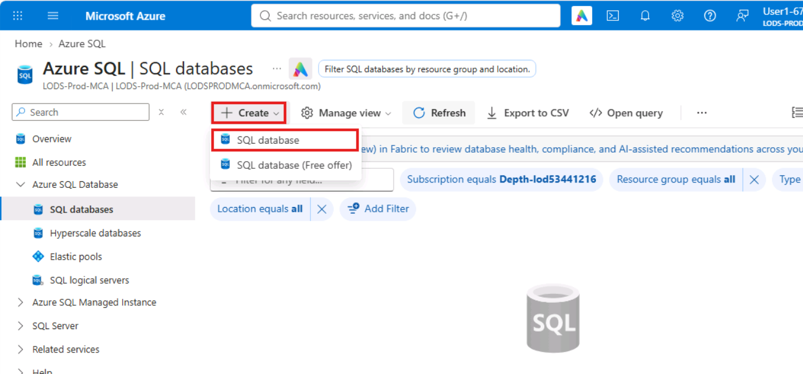

4.  On the **Basics** tab, set **Resource group** to **ResourceGroup1**
    and **Database name** to +++ReportingHS+++. Under **Server**, click **Create new**.

    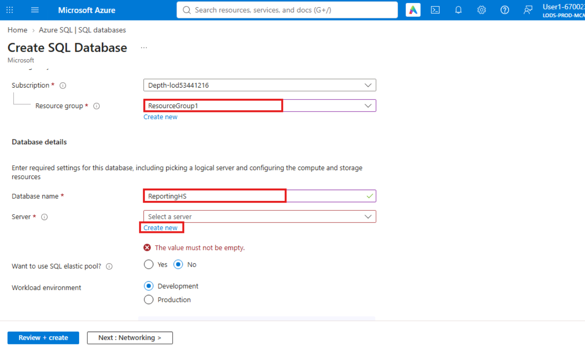

5.  In the **Create SQL Database Server** pane, set **Server name** to
    +++sql-fabrikam-hs-jd427+++, **Location** to **Central US**,
    **Authentication method** to **Use SQL authentication**, **Server
    admin login** to +++sqladminuser+++, and **Password** and **Confirm
    password** to +++Fabrikam!Lab2026+++. Click **OK**.

    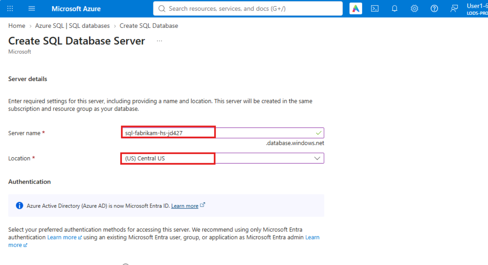

    

6.  Set **Want to use SQL elastic pool?** to **No** and **Workload environment** to **Development**.

    

7.  Under **Compute + storage**, click **Configure database**.

    

8.  Set the following:

    1.  **Service tier:** Hyperscale (On-demand scalable storage)

    2.  **Compute tier:** Provisioned

    3.  **Hardware configuration:** Standard-series (Gen5)

    4.  **vCores:** 2

    5.  **High-availability secondary replicas:** 0

    6.  **Would you like to make this database zone redundant?** No

    Click **Apply**.

    **Why 0 high-availability replicas?** This lab uses a named replica
    for read scale-out instead, and 0 keeps the cost low. In production,
    add at least one high-availability replica, so a failover takes
    seconds instead of minutes.

    **Zone redundancy is a creation-time decision for Hyperscale.** You
    can’t change it after the database is created, so in production decide
    it now.

    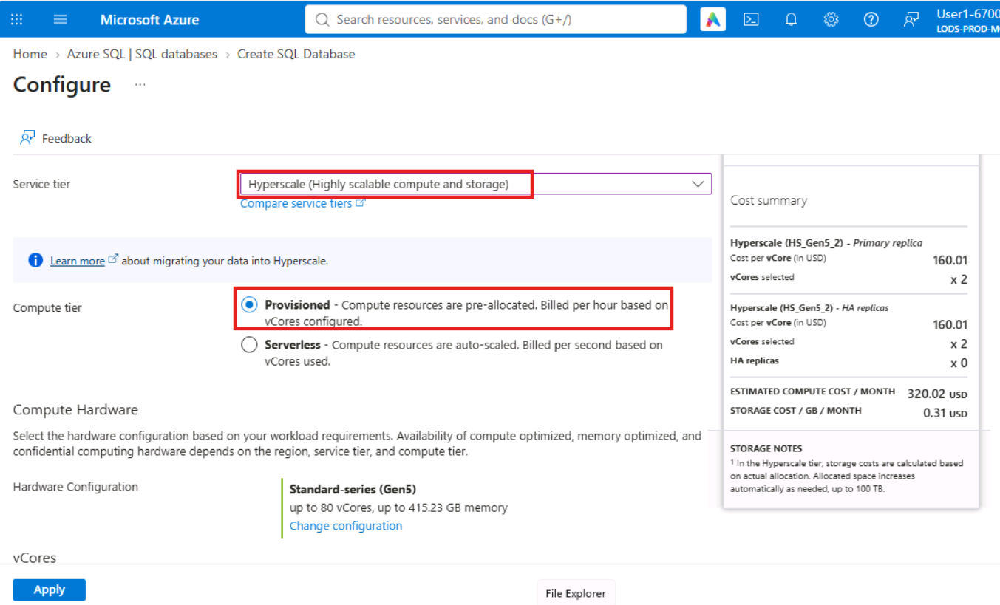

    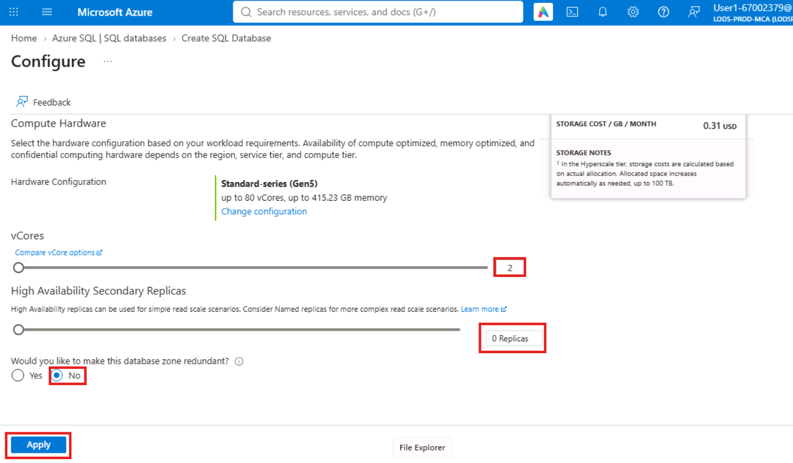

9.  Under **Backup storage redundancy**, select **Locally-redundant backup storage**.

    

10. Click **Next: Networking**. Set **Connectivity method** to **Public
    endpoint**, **Allow Azure services and resources to access this
    server** to **No**, and **Add current client IP address** to
    **Yes**.

    

11. Click the **Additional settings** tab. Set **Use existing data** to
    **Sample**, and click **OK** in the confirmation dialog.

    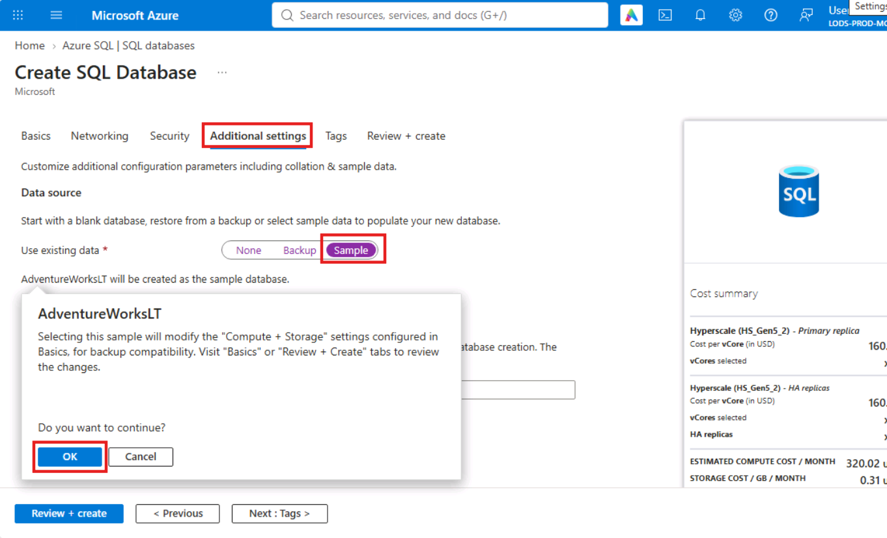

12. Click **Review + create**.

    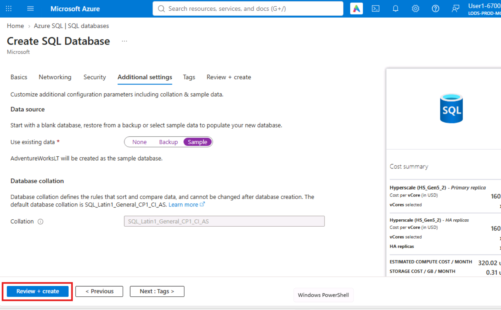

13. Then click on **Create**.

    

    **Expected result:** **Your deployment is complete** after 3 to 6
    minutes. Click **Go to resource**.
    
    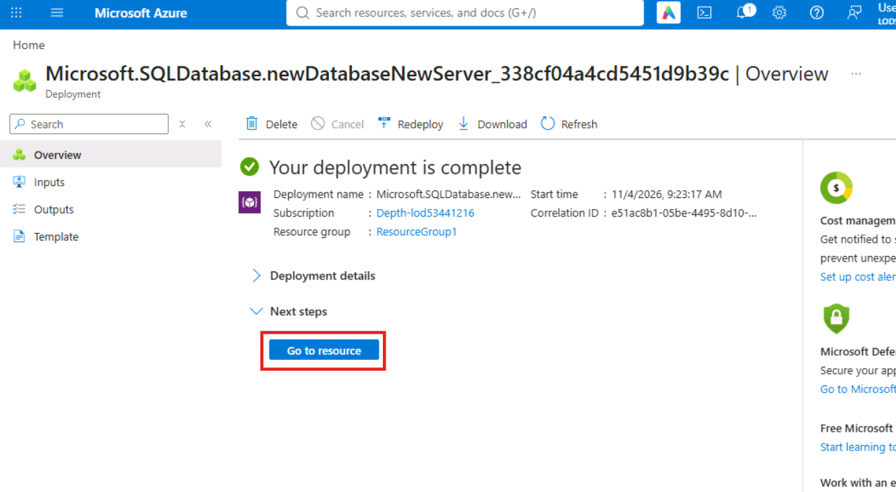

### **Task 2: Explore the Hyperscale architecture**

1.  On the **ReportingHS** page, in the left menu, click **Query
    editor**.

    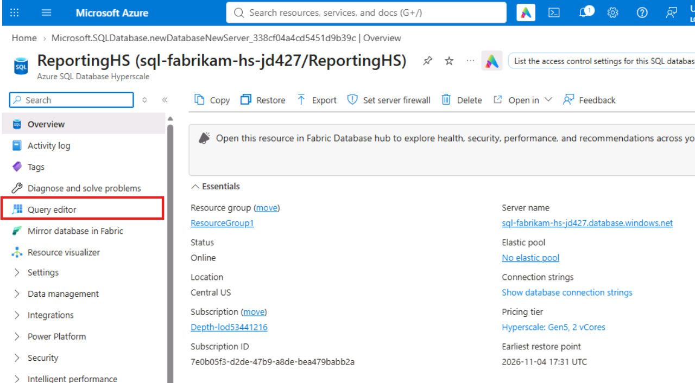

2.  On the **SQL server authentication** tab, enter +++sqladminuser+++ and
    +++Fabrikam!Lab2026+++, and click **OK**. If you see a firewall error,
    click **Allowlist IP** in the message, then click **OK** again.

    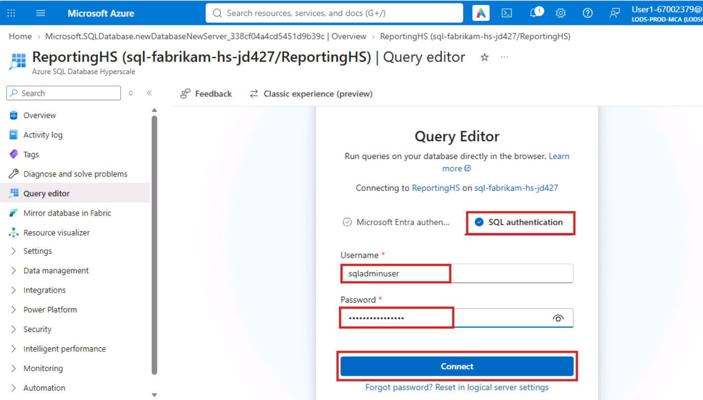

3.  Click **New query**.

    

4.  Paste this query and click **Run**:

    **T-SQL**

    ```
    SELECT DATABASEPROPERTYEX(DB_NAME(), 'Edition') AS edition,
       DATABASEPROPERTYEX(DB_NAME(), 'ServiceObjective') AS service_objective,
       DATABASEPROPERTYEX(DB_NAME(), 'Updateability') AS updateability,
       (SELECT COUNT(*) FROM SalesLT.Customer) AS customer_rows;
    ```

    **Expected result:** edition **Hyperscale**, service_objective
    **HS_Gen5_2**, updateability **READ_WRITE** and customer_rows **847**.

    

5.  Clear the editor and run:

    **T-SQL**

    ```
    SELECT file_id, type_desc, name, size * 8 / 1024 AS size_mb
    FROM sys.database_files
    ORDER BY type_desc, file_id;
    ```

    **Expected result:** one or more **ROWS** files and one **LOG** file.
    In Hyperscale, each data file is held by a separate **page server**,
    and compute nodes read pages from them on demand. That separation of
    compute from storage is what lets Hyperscale grow to 128 TB and add
    replicas without copying data.

    

## **Exercise 2: Isolate Reporting and AI Workloads with a Named Replica**

A named replica is a read-only database with its own name and its own
compute, sharing the primary’s storage. You create one for the Power BI
dashboards and the AI forecasting service, so their heavy reads never
compete with the daily feed on the primary.

### **Task 1: Create the named replica**

1.  In the left menu, click **Data management \> Replicas**. Click **+ Create replica**.

    

2.  The Create **SQL Database** - **Replica** page opens on the
    **Basics** tab. Subscription, Resource group, Primary database and
    Region are greyed out because they come from the primary database.
    Scroll down below **Region**, and under Replica configuration, set
    **Replica type** to **Named replica**.

    Don’t click **Review + create** yet. The settings you need are lower on this tab.

    

3.  Set **Server** to **sql-fabrikam-hs-jd427** (the same server as the
    primary) and **Database name** to +++ReportingHS_AI+++.

4.  Under **Compute + storage**, click **Configure database**.

    

5.  Check that **vCores** is **2**, set **High-availability secondary
    replicas** to **0** and **Would you like to make this database zone
    redundant?** to **No**, and click **Apply**.

    

6.  Click **Review + create**, then **Create**.

    

    

    **Expected result:** the deployment completes in about a minute. No
    data is copied, because the named replica reads the same page servers
    as the primary.

7.  Navigate to **Home** and open **ReportingHS**.

    

8.  Return to **ReportingHS \> Data management \> Replicas**.

    **Expected result:** **ReportingHS_AI** is listed under **Named replicas**.

    

### **Task 2: Prove the replica is read-only and in sync**

1.  On the **ReportingHS** page (the primary), open **Query editor** and
    run this query. It creates a small table for the daily sales feed
    and writes two rows:

    **T-SQL (on ReportingHS)**

    ```
    CREATE TABLE dbo.DailySalesFeed (FeedDate date PRIMARY KEY, Orders int NOT NULL);
    INSERT dbo.DailySalesFeed VALUES ('2026-07-01', 1250), ('2026-07-02', 1310);
    SELECT * FROM dbo.DailySalesFeed;
    ```

    **Expected result:** two rows.

    

    

2.  In the portal search bar, type +++SQL databases+++, select **Azure SQL Database** under **Services**.

    

3.  Select **Hyperscale databases** to see **ReportingHS** and
    **ReportingHS_AI**.

    Click **ReportingHS_AI**.

    

4.  In the left menu, click **Query editor** and sign in with
    +++sqladminuser+++ and +++Fabrikam!Lab2026+++.

    

5.  Run this query on the named replica:

    **T-SQL (on ReportingHS_AI)**

    ```
    SELECT DATABASEPROPERTYEX(DB_NAME(), 'Updateability') AS updateability,
       DATABASEPROPERTYEX(DB_NAME(), 'ServiceObjective') AS service_objective;
    SELECT * FROM dbo.DailySalesFeed;
    ```

    **Expected result:** updateability **READ_ONLY**, service_objective
    **HS_Gen5_2**, and the same two rows you inserted on the primary. The
    editor may show only the last result set, the two rows; that is
    expected. The replica sees new data within seconds, without any copy
    or refresh job.

    

6.  Clear the editor and try to write to the named replica:

    **T-SQL (on ReportingHS_AI)**

    ```
    INSERT dbo.DailySalesFeed VALUES ('2026-07-03', 1400);
    ```

    **Expected result:** the query fails on purpose with an error saying
    the database is **read-only** (error 3906), followed by **Failed to
    execute the query**. Named replicas accept reads only, so a dashboard
    or AI service connected to one can’t change the data.

    

### **Task 3: Run an analytics workload on the replica**

1.  Clear the editor and run this aggregation on **ReportingHS_AI**. It
    is the kind of query the forecasting service would run to build its
    training data:

    **T-SQL (on ReportingHS_AI)**

    ```
    SELECT pc.Name AS category,
       COUNT(DISTINCT h.SalesOrderID) AS orders,
       SUM(d.LineTotal) AS revenue,
       AVG(d.UnitPrice) AS avg_unit_price
    FROM SalesLT.SalesOrderDetail AS d
    JOIN SalesLT.SalesOrderHeader AS h ON h.SalesOrderID = d.SalesOrderID
    JOIN SalesLT.Product AS p ON p.ProductID = d.ProductID
    JOIN SalesLT.ProductCategory AS pc ON pc.ProductCategoryID = p.ProductCategoryID
    GROUP BY pc.Name
    ORDER BY revenue DESC;
    ```

    **Expected result:** one row per product category, ordered by revenue.
    The query ran on the named replica’s own 2 vCores, so it used none of
    the primary’s CPU or memory.

    **Workload prioritization in practice:** the daily feed on the primary
    is the business-critical workload. Dashboards and AI forecasting are
    lower priority and can tolerate a few seconds of data latency. Giving
    them a named replica means a runaway report or a large AI query can
    only slow itself down. In production, you can create up to 30 named
    replicas, for example one per team or application.

    

## **Exercise 3: Scale Hyperscale Compute Independently**

The forecasting team expects the daily feed to double during the holiday
season. You scale up the primary for the busy period while the named
replica keeps its own size.

### **Task 1: Scale up the primary**

1.  Open the **ReportingHS** database page. In the left menu, click
    **Settings \> Compute + storage**.

    

2.  Change **vCores** from **2** to **4**. Leave every other setting
    unchanged and click **Apply**.

    

3.  Click the **Notifications** (bell) icon and note how long the
    scaling operation takes.

    **Expected result:** the operation completes in a few minutes.
    Hyperscale scales compute in about the same time whatever the database
    size, because no data is copied; a new compute node attaches to the
    same page servers. In General Purpose, scaling a large database can
    take much longer.

    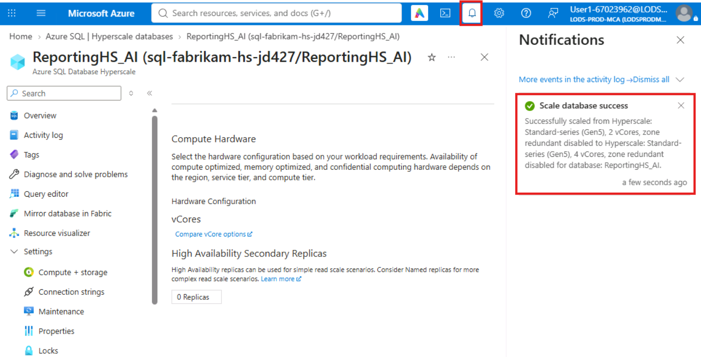

### **Task 2: Confirm the replica kept its own size**

1.  Open **ReportingHS_AI**, open **Query editor**, and run the same
    query.

    **Expected result:** database_name **ReportingHS_AI** and
    service_objective **HS_Gen5_2**. The primary and the named replica
    scale separately, so you can size each workload for its own demand.

    

2.  On **ReportingHS**, open **Query editor** and run:

    **T-SQL (on ReportingHS)**

    ```
    SELECT DB_NAME() AS database_name, DATABASEPROPERTYEX(DB_NAME(), 'ServiceObjective') AS service_objective;
    ```

    **Expected result:** database_name **ReportingHS** and
    service_objective **HS_Gen5_4**.

    

## **Conclusion**

In this lab, you evaluated Azure SQL Database Hyperscale as the new
destination for Fabrik’s ReportingDB. You deployed a Hyperscale database
and saw how page servers separate storage from compute, which removes
the 4 TB limit of General Purpose. You then created a named replica that
isolates the reporting and AI workloads from the business-critical daily
feed, and proved it is read-only and stays in sync with the primary.
Finally, you scaled the primary independently of the replica in minutes,
and reviewed why choosing Hyperscale is a one-way decision that must be
justified by real requirements.

## **Clean Up Resources**

Delete the Lab 6 resources but keep **ResourceGroup1**:

1.  In the portal search bar, type +++SQL servers+++ and select **SQL
    servers** under **Services**.

    

2.  Click **sql-fabrikam-hs-jd427**.

    

3.  On the toolbar, click **Delete**. Type the server name to confirm
    and click **Delete**. Deleting the server also deletes
    **ReportingHS** and **ReportingHS_AI**.

    

    

    

4.  In the portal search bar, type **All resources** and select **All
    resources**. Set the **Resource group** filter to **ResourceGroup1**
    and click **Refresh**.

    **Expected result:** none of the Lab 6 resources is listed, and
    **ResourceGroup1** still exists.
