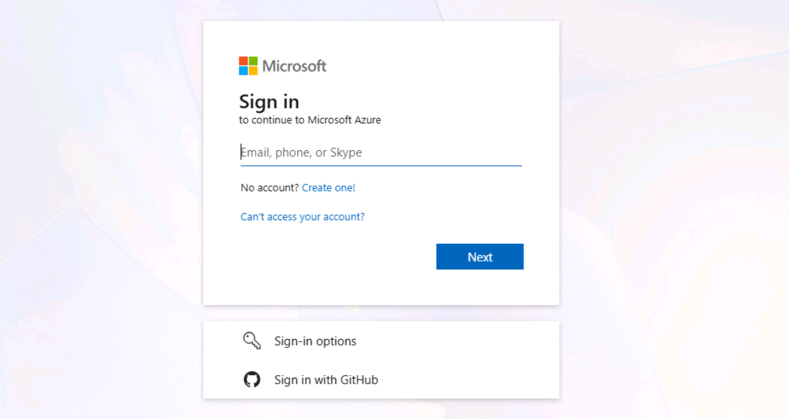
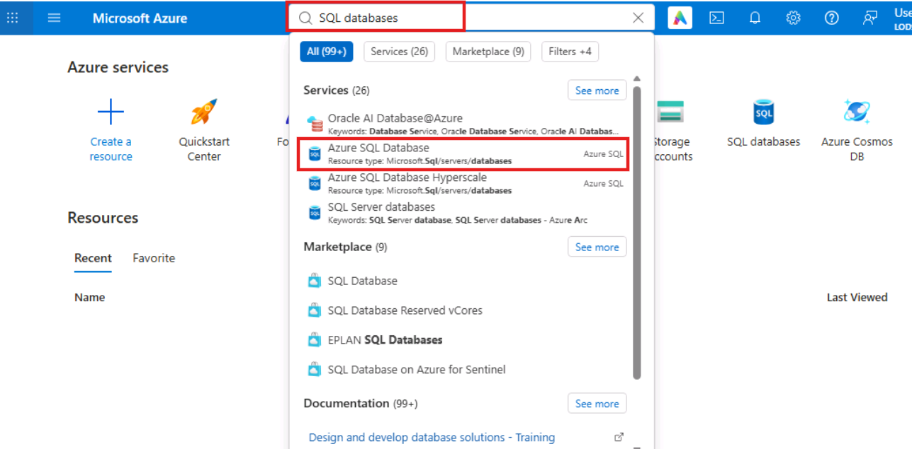
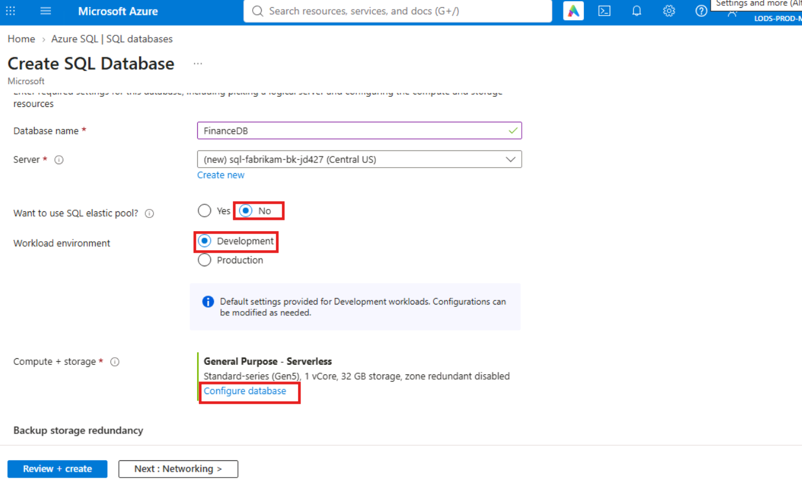
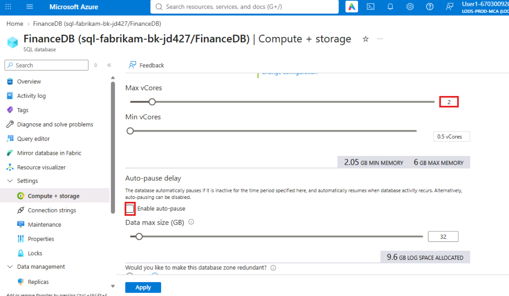
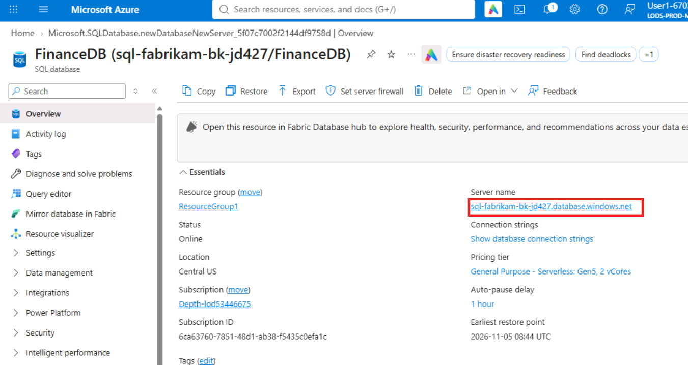
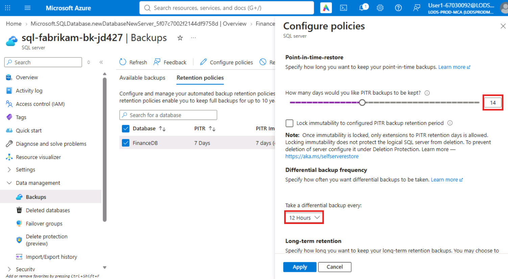
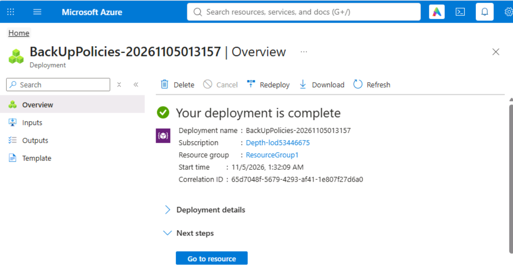
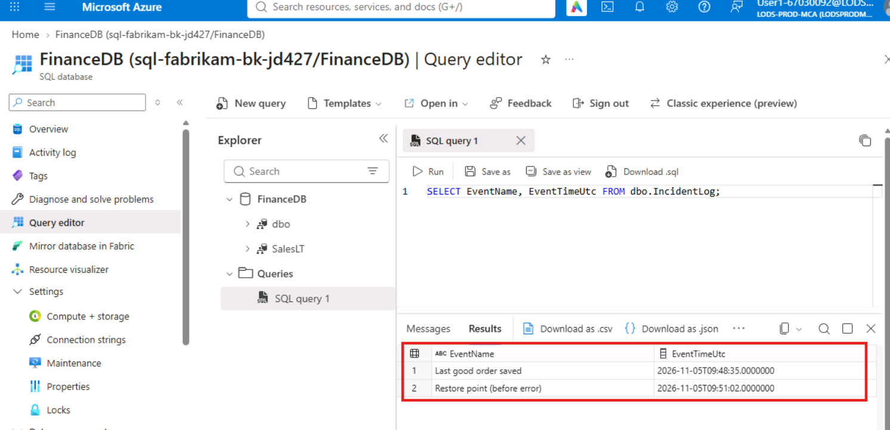

# **Lab 7: Implement Backup Retention and Point-in-Time Recovery**

**Lab overview**

Fabrikam Retail’s FinanceDB is now in Azure SQL Database. Before
go-live, the Finance and Compliance teams set these requirements:

- **Operator errors:** if someone damages data, Fabrikam must recover
  everything up to the moment before the mistake (RPO of a few minutes)
  within 1 hour (RTO).

- **Short-term recovery window:** errors are often found at the next
  weekly close, so data must be recoverable to any point in the last 14
  days.

- **Compliance:** keep one backup per month for 12 months and one backup
  per year for 7 years.

- **Regional outage:** the backups must survive the loss of the whole
  primary region.

You configure FinanceDB to meet these requirements and prove the
recovery works.

**Objectives**

After completing this lab, you will be able to:

- Choose a backup storage redundancy that matches a regional-outage
  requirement, and explain its cost.

- Configure the point-in-time restore window, differential backup
  frequency and long-term retention policies.

- Recover from an operator error by restoring a database to a point in
  time just before the mistake.

- Restore a dropped database from its retained backups.

- Measure the recovery point and recovery time you achieved against the
  targets.

### **Getting Started: Deploy FinanceDB**

#### **Task 1: Create the database with geo-redundant backups**

1.  Open [***portal.azure.com***](https://portal.azure.com/) and sign in
    with your lab account.

> 

2.  In the portal search bar, type **SQL databases**. Under
    **Services**, select **Azure SQL Database**.

> 

3.  Click **+ Create**. If a menu opens, select **SQL database**.

> 

4.  On the **Basics** tab, set **Resource group** to **ResourceGroup1**
    and **Database name** to **FinanceDB**. Under **Server**, click
    **Create new**.

> 

5.  In the **Create SQL Database Server** pane, set **Server name** to
    **sql-fabrikam-bk-jd427**, **Location** to **Central US**,
    **Authentication method** to **Use SQL authentication**, **Server
    admin login** to **sqladminuser**, and **Password** and **Confirm
    password** to **Fabrikam!Lab2026**. Click **OK**.

> 

6.  Set **Want to use SQL elastic pool?** to **No** and **Workload
    environment** to **Development**. Under **Compute + storage**, click
    **Configure database**.

> 

7.  Under **Compute + storage**, click **Configure database**. Set
    **Service tier** to **General** **Purpose**, **Compute** tier to
    **Serverless** and **Max vCores** to **2**. Under **Auto-pause
    delay**, disable **Enable auto-pause**. Set **Would you like to make
    this database zone redundant?** to **No**. Click **Apply**.

> 
>
> 
>
> 

8.  Under **Backup storage redundancy**, select **Geo-redundant backup
    storage**.

> **Why geo-redundant?** It is the option that meets the regional-outage
> requirement. Geo-redundant backups are copied to the paired region, so
> you can geo-restore the database there if Central US is lost.
> Locally-redundant and zone-redundant backups stay in Central US.
> Geo-redundant backup storage costs about twice as much per GB as
> locally-redundant, so choose it only when the requirement is real.
>
> 

9.  Click **Next: Networking**. Set **Connectivity method** to **Public
    endpoint**, **Allow Azure services and resources to access this
    server** to **No**, and **Add current client IP address** to
    **Yes**.

> 

10. Click the **Additional settings** tab. Set **Use existing data** to
    **Sample** and click **OK** in the confirmation dialog.

> 

11. Click **Review + create**, then **Create**.

> 
>
> 
>
> **Expected result:** **Your deployment is complete** after 3 to 5
> minutes. Azure takes the first full backup automatically as soon as
> the database exists.

### **Exercise 1: Configure Backup Retention to Meet the Recovery Objectives**

Azure SQL Database backs up every database automatically: full backups
weekly, differential backups every 12 or 24 hours, and transaction log
backups about every 10 minutes. You can’t switch these off, but you
decide how long they are kept. Short-term retention controls the
point-in-time restore window. Long-term retention (LTR) keeps selected
full backups for up to 10 years.

#### **Task 1: Set short-term retention**

1.  Open the server from the database: on the **FinanceDB** **Overview**
    page, in the **Essentials** section, click the **Server name** link
    (sql-fabrikam-bk-jd427.database.windows.net).

> 

2.  In the server’s left menu, click **Data management \> Backups**,
    then click the **Retention policies** tab.

> 

3.  Select the check box for **FinanceDB** and click **Configure
    policies** on the toolbar.

> 

4.  Under **Point-in-time restore**, set:

- **How many days would you like PITR backups to be kept?** 14 days

- **How often would you like differential backups to be taken?** 12
  hours

**Why 14 days?** It covers Fabrikam’s weekly-close requirement with a
week to spare. The default is 7 days, and the maximum is 35. Longer
retention keeps more backup data, and backup storage above the
database’s size is billed per GB.

**Why 12 hours?** A restore replays the last full backup, then the
latest differential, then the log backups after it. More frequent
differentials mean fewer log backups to replay, which shortens the
restore time (RTO).

#### **Task 2: Set long-term retention**

1.  In the same pane, under **Long-term retention**, set:

- **Weekly LTR backups:** leave cleared

- **Monthly LTR backups:** select it, and set **Keep the first backup of
  each month for** to **12 months**

- **Yearly LTR backups:** select it, set **Keep the backup for** to **7
  years**, and set **Which weekly backup of the year would you like to
  keep?** to **Week 1**

> Click **Apply**.
>
> 

2.  Click **Yes** if asked to confirm.

> 
>
> **Expected result:** a notification confirms the policies were
> updated.
>
> 
>
> On the **Retention policies** tab, the **FinanceDB** row shows **14
> days** for PITR and the monthly and yearly LTR settings.
>
> **When do LTR backups appear?** LTR copies the weekly full backup that
> matches the policy, so the first one can take up to 7 days to appear.
> That is normal; you don’t need to wait for it in this lab.
>
> 

#### **Task 3: Check the recovery window**

1.  Click the **Available backups** tab and find **FinanceDB**.

> **Expected result:** FinanceDB shows an **Earliest PITR restore
> point** a few minutes after the database was created. That is the
> first full backup. From now on, the restore window grows until it
> reaches 14 days.
>
> 

### **Exercise 2: Recover from an Operator Error with Point-in-Time Restore**

An analyst runs a price update without a WHERE clause and sets every
product’s list price to zero. Just before that, a new order was saved.
You restore FinanceDB to the moment just before the mistake and check
that both the prices and the new order are back.

#### **Task 1: Simulate the incident**

1.  Open the database **FinanceDB**.

> 

2.  In the left menu, click **Query editor**. On the **SQL server
    authentication** tab, enter **sqladminuser** and
    **Fabrikam!Lab2026** and click **OK**.

> 

3.  Click **New query**.

> 

4.  Paste this and click **Run**. It saves a new order, the last good
    change before the mistake:

> **T-SQL**
>
> CREATE TABLE dbo.IncidentLog (EventName nvarchar(50) PRIMARY KEY,
> EventTimeUtc datetime2(0) NOT NULL);
>
> INSERT dbo.IncidentLog VALUES (N'Last good order saved',
> SYSUTCDATETIME());
>
> SELECT \* FROM dbo.IncidentLog;
>
> **Expected result:** one row. Note the **EventTimeUtc** value.
>
> 

5.  Wait **2 minutes**. Then clear the editor and run this. It records
    the restore point you will use, then makes the mistake:

> **T-SQL**
>
> INSERT dbo.IncidentLog VALUES (N'Restore point (before error)',
> SYSUTCDATETIME());
>
> WAITFOR DELAY '00:01:05';
>
> UPDATE SalesLT.Product SET ListPrice = 0; -- the mistake: no WHERE
> clause
>
> SELECT EventName, EventTimeUtc FROM dbo.IncidentLog;
>
> SELECT COUNT(\*) AS products_with_zero_price FROM SalesLT.Product
> WHERE ListPrice = 0;
>
> **Expected result:** after about a minute, the editor shows
> **products_with_zero_price** as **295** (every product). The editor
> may show only the last result set; that is expected.
>
> 

6.  Clear the editor and run:

> **T-SQL**
>
> SELECT EventName, EventTimeUtc FROM dbo.IncidentLog;
>
> **Expected result:** two rows. Write down the **EventTimeUtc** of
> **Restore point (before error)**, rounded **down** to the minute, for
> example **2026-07-14 09:42**. The error happened about a minute later.
>
> 

#### **Task 2: Restore to the point before the error**

1.  Open the **Overview** page of **FinanceDB**. On the toolbar, click
    **Restore**.

> 

2.  On the **Basics** tab, set:

- **Restore source:** Point-in-time

- **Restore point (UTC):** the **EventTimeUtc** of the **Restore point
  (before error)** row from Task 1, rounded down to the minute (not the
  **Last good order saved** time). For example, for **2026-11-05
  01:42:37**, enter the date **2026-11-05** and the time **01:42**. If
  the time picker uses a 12-hour clock, choose **AM** or **PM** to
  match.

- **Database name:** FinanceDB_restored

- **Server:** sql-fabrikam-bk-jd427 (leave the default)

> 

3.  Under **Compute + storage**, check that it shows **General Purpose -
    Serverless**, 2 vCores. If it shows something else, click
    **Configure database** and set it to match FinanceDB, with zone
    redundancy set to **No**.

> 

4.  Click **Review + create**, then **Create**. Note the time you
    clicked **Create**.

> 
>
> 
>
> **“The restore point is later than the latest available”?** The log
> backup that covers your restore point hasn’t been taken yet; log
> backups run about every 10 minutes. Wait 5 minutes and click
> **Create** again.
>
> **Expected result:** the deployment takes 5 to 10 minutes. A restore
> always creates a new database; it never overwrites FinanceDB. While
> you wait, read Task 3.

#### **Task 3: Verify the recovery and measure RPO and RTO**

1.  When the deployment completes, click **Go to resource**.

> 

2.  In **FinanceDB_restored**, open **Query editor**, sign in and run:

> **T-SQL (on FinanceDB_restored)**
>
> SELECT EventName, EventTimeUtc FROM dbo.IncidentLog;
>
> SELECT COUNT(\*) AS products_with_zero_price,
>
> (SELECT COUNT(\*) FROM SalesLT.Product) AS products
>
> FROM SalesLT.Product WHERE ListPrice = 0;
>
> **Expected result:** both IncidentLog rows, including **Last good
> order saved**, and **products_with_zero_price** of **0** out of
> **295** products. The prices are back, and nothing saved before the
> error was lost.
>
> 
>
> 

3.  Find the restore duration: in the portal search bar, type **Resource
    groups**.

> 

4.  Open **ResourceGroup1**.

> 

5.  In the left menu, click **Settings \> Deployments**. Open the newest
    deployment (its name contains **restore** or **FinanceDB_restored**)
    and check its **Duration**.

> **Expected result:** a duration of about 5 to 10 minutes.
>
> 
>
> **What you achieved:**

- **RPO:** the restored data stops about a minute before the error, at
  the point you chose, so the only data lost is whatever was written in
  that last minute. In a real incident you would choose a point seconds
  before the error.

- **RTO:** about 10 minutes for this small database, well inside the
  1-hour target. Restore time grows with database size and with the
  amount of log to replay, so test it again with production-sized data.

- **Repairing production:** Azure SQL Database can’t query across
  databases, as you saw in Lab 5, so you can’t copy the prices back with
  one UPDATE. The options are to point the application at
  FinanceDB_restored, or to export the good rows and load them into
  FinanceDB.

### **Exercise 3: Recover a Dropped Database**

A cleanup script deletes the wrong database. Deleted databases keep
their backups for the rest of the retention period, so you can restore
them.

#### **Task 1: Drop a database**

1.  Open **FinanceDB_restored**. On the **Overview** page, click
    **Delete** on the toolbar.

> 

2.  Type **FinanceDB_restored** to confirm and click **Delete**.

> 
>
> **Expected result:** a notification confirms the deletion after a
> minute or two.
>
> 

#### **Task 2: Restore the dropped database**

1.  Open the server **sql-fabrikam-bk-jd427**.

> 

2.  In the left menu, click **Data management \> Deleted databases**. If
    your portal doesn’t show that item, click **Data management \>
    Backups** and look for the **Deleted databases** tab or section.

3.  Click **Refresh** until **FinanceDB_restored** appears, with its
    **Deletion time**. It can take up to 10 minutes to be listed.

> 

4.  Click **FinanceDB_restored** in the list. On the **Create SQL
    Database - Restore database** page, set **Database name** to
    **FinanceDB_recovered**, leave **Restore point** at the deletion
    time, and check that **Compute + storage** shows **General Purpose -
    Serverless**. Click **Review + create**, then **Create**.

> 
>
> 
>
> **Expected result:** the deployment completes in 5 to 10 minutes.
>
> **Deleted databases are kept only until their retention period ends.**
> FinanceDB_restored kept the server’s default retention (7 days), not
> FinanceDB’s 14 days, because retention policies are set per database.
> After 7 days its backups are gone for good.
>
> 

#### **Task 3: Confirm the recovery**

1.  Open **FinanceDB_recovered** and open **Query editor**. Sign in:

> 

2.  Run:

> **T-SQL (on FinanceDB_recovered)**
>
> SELECT COUNT(\*) AS incident_rows FROM dbo.IncidentLog;
>
> SELECT COUNT(\*) AS products_with_zero_price FROM SalesLT.Product
> WHERE ListPrice = 0;
>
> **Expected result:** incident_rows **2** and products_with_zero_price
> **0**. The dropped database came back exactly as it was at the moment
> it was deleted.
>
> 

3.  Return to **sql-fabrikam-bk-jd427 \> Data management \> Backups**,
    click the **Retention policies** tab, and look at the
    **FinanceDB_recovered** row.

> 
>
> 
>
> **Expected result:** FinanceDB_recovered has the default **7 days**
> PITR retention and no LTR policy. A restored database doesn’t inherit
> the source’s retention policies.
>
> 
>
> **Restore checklist:** after any restore, set the retention policies,
> firewall rules, logins and alerts the original database had. A
> database that is recovered but not protected is the next incident
> waiting to happen.

### **Conclusion**

In this lab, you configured FinanceDB to meet Fabrikam’s recovery
requirements and proved that recovery works inside one region. You chose
geo-redundant backup storage for the regional-outage requirement and
weighed its cost. You set a 14-day point-in-time restore window, 12-hour
differential backups and long-term retention of monthly and yearly
backups for compliance. You then recovered from an operator error by
restoring to the minute before the mistake, restored a dropped database,
and measured the recovery point and recovery time you achieved against
the targets.

### **Clean Up Resources**

Delete the Lab 7 resources but keep **ResourceGroup1**:

1.  In the portal search bar, type **SQL servers**, select **SQL
    servers** under **Services**, and click **sql-fabrikam-bk-jd427**.

2.  On the toolbar, click **Delete**. Type the server name to confirm
    and click **Delete**. Deleting the server deletes every database on
    it.

> **Point-in-time backups are lost when you delete the server,** so you
> can no longer restore these databases. LTR backups are different: they
> are kept, and billed, until they expire, even after the server is
> deleted. This lab created no LTR backups yet, so nothing is left
> behind.

3.  In the portal search bar, type **All resources** and select **All
    resources**. Set the **Resource group** filter to **ResourceGroup1**
    and click **Refresh**.

> **Expected result:** none of the Lab 7 resources is listed, and
> **ResourceGroup1** still exists.
